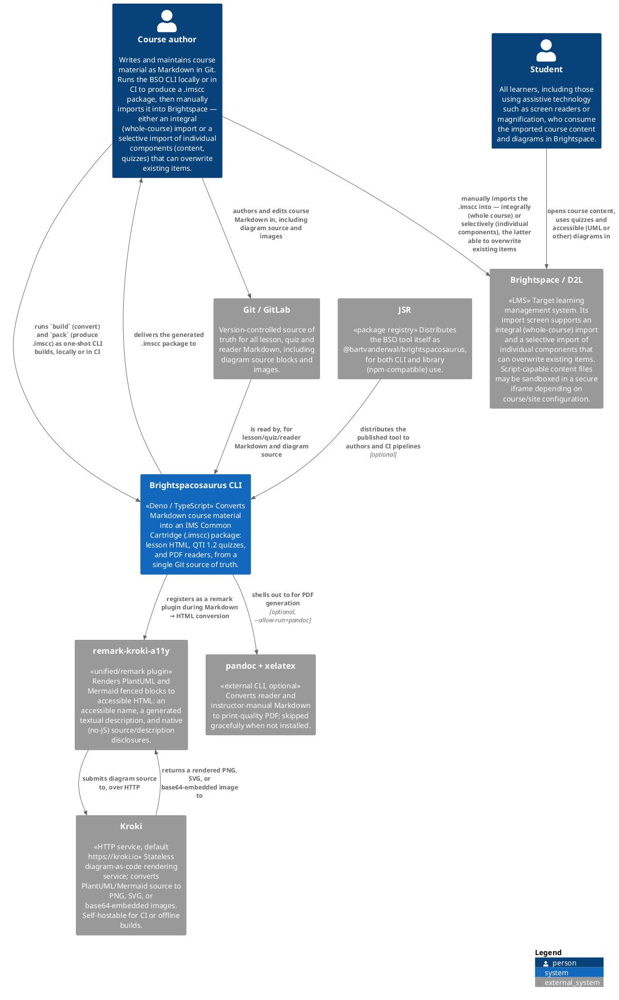
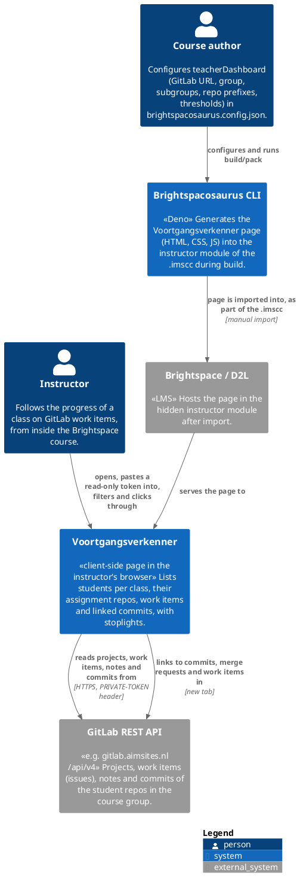
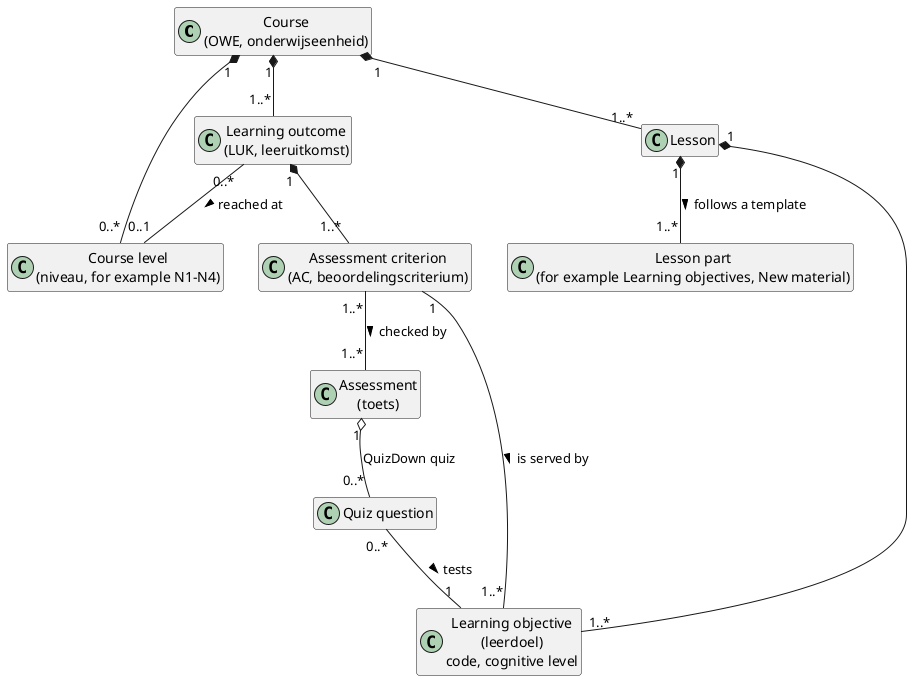
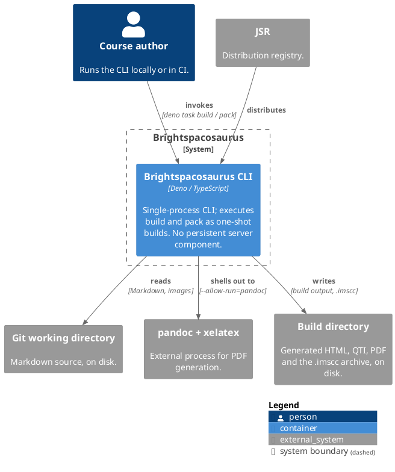
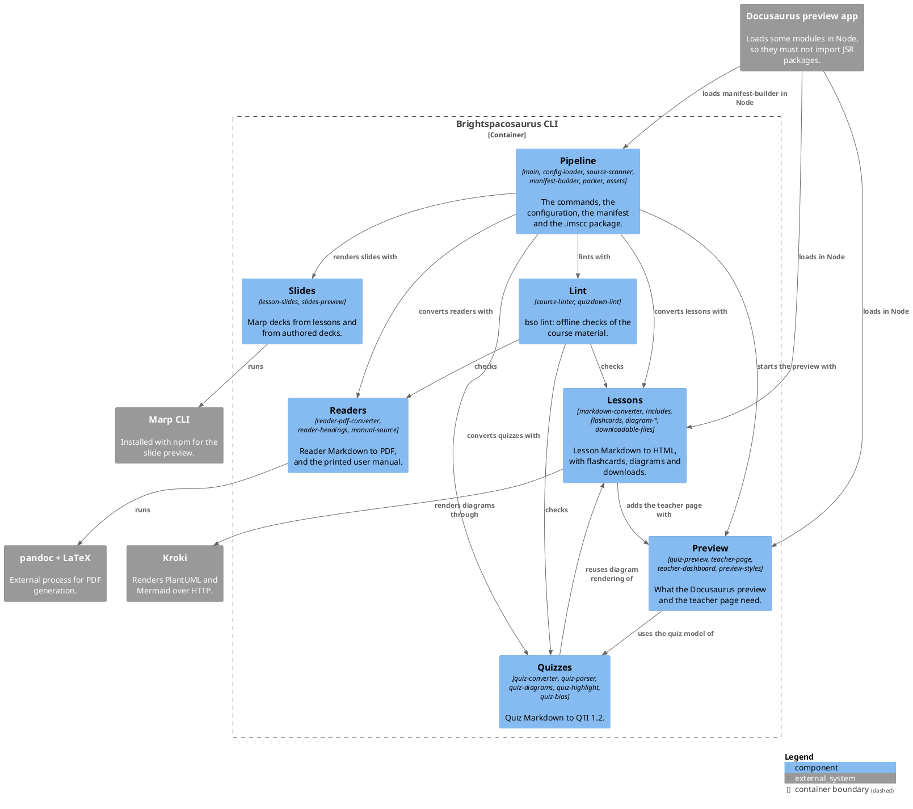
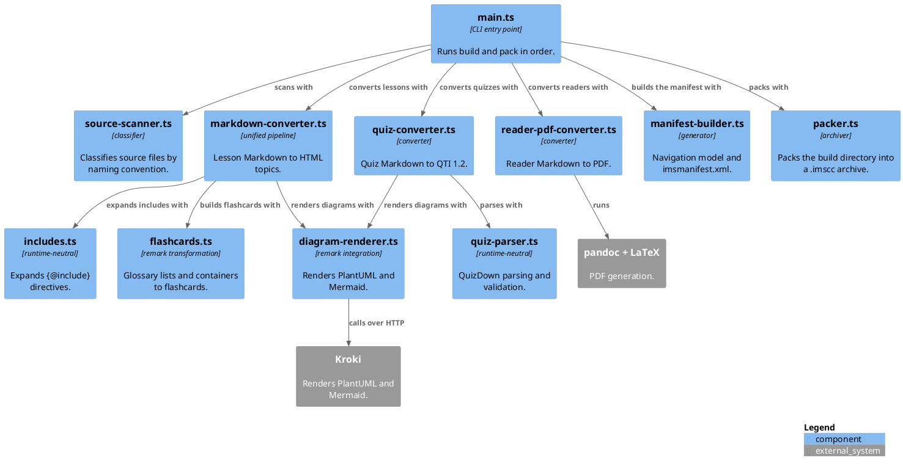

# Brightspacosaurus — Software Guidebook

Brightspacosaurus (BSO) is a CLI build tool that converts Markdown course material in Git into an IMS Common Cartridge (`.imscc`) package for import into Brightspace.

This guidebook follows the structure of Simon Brown's [Software Guidebook](https://leanpub.com/software-architecture-for-developers) (the C4 model author). It is developer- and architect-facing documentation. For user-facing details (installation, configuration fields, the Brightspace import walkthrough), see the [README](../README.md) and the [user manual](user-manual.md) rather than duplicating them here.

---

## 1. Context

This chapter describes the world around BSO: the problem it solves, who uses it and which systems it works with. Read it first if you are new to the project.

- **1.1** The problem
- **1.2** Actors and external systems
- **1.3** System context
- **1.4** A note on "import" vs "export"
- **1.5** Diagram rendering in context
- **1.6** Voortgangsverkenner in context

### 1.1 The problem

Course authors want a single source of truth for their material. Keeping content as Markdown in Git gives them version control, review workflows, diffs, and reuse. Brightspace (the target LMS) offers none of that: its authoring surface is a WYSIWYG editor where content is re-typed by hand. Re-authoring material directly in Brightspace is error-prone, not reviewable, and drifts away from the source over time.

BSO bridges that gap. It takes the Markdown that already lives in Git and produces a Common Cartridge package that Brightspace can import — so the author edits in one place (Git) and publishes to another (Brightspace) with a repeatable build step.

### 1.2 Actors and external systems

| Actor / System                                                     | Role                                                                                                                                                                                                                                                                                                                                                                                                                                                                                                     |
| ------------------------------------------------------------------ | -------------------------------------------------------------------------------------------------------------------------------------------------------------------------------------------------------------------------------------------------------------------------------------------------------------------------------------------------------------------------------------------------------------------------------------------------------------------------------------------------------- |
| Course author                                                      | Writes and maintains course material as Markdown in Git; runs the CLI (`build`, `pack`) locally or in CI; sets diagram configuration (endpoint, rendering mode). After the build, the author manually imports the resulting `.imscc` into Brightspace, choosing an **integral import** (the whole course as one package) or a **selective import** of individual components (content topics, quizzes) — a selective import can overwrite items already present in the course with the same identifier. |
| Student (all learners, including those using assistive technology) | Consumes the imported course in Brightspace, including diagrams and accessibility features. BSO does not rely on custom JavaScript for diagram controls, because Brightspace content sandboxing and content frames are security-sensitive and tenant/course dependent.                                                                                                                                                                                                                                    |
| Git / GitLab                                                       | Source of truth for all course material and diagram source blocks.                                                                                                                                                                                                                                                                                                                                                                                                                                       |
| Brightspace / D2L                                                  | Target LMS; the manual import destination for the generated `.imscc`. Its import UI offers both integral and selective/overwrite import; BSO has no programmatic API into it. Content files that execute scripts may be sandboxed in a secure iframe, depending on Brightspace configuration.                                                                                                                                                                                                            |
| JSR                                                                | Distribution registry for the BSO tool itself (`@bartvanderwal/brightspacosaurus`).                                                                                                                                                                                                                                                                                                                                                                                                                      |
| remark-kroki-a11y                                                  | Unified (remark) plugin for rendering PlantUML and Mermaid diagrams to accessible HTML with disclosure controls and natural-language descriptions.                                                                                                                                                                                                                                                                                                                                                       |
| Kroki                                                              | Diagram rendering service (default public https://kroki.io; can be self-hosted for CI/offline builds). Renders diagram source to PNG, SVG, or base64-embedded images over HTTP.                                                                                                                                                                                                                                                                                                                          |
| pandoc                                                             | External CLI tool used for PDF generation (readers, instructor manual), invoked via `--allow-run=pandoc`. Optional; skipped gracefully when absent.                                                                                                                                                                                                                                                                                                                                                      |
| Instructor | Hides the instructor module after import and opens the **Voortgangsverkenner** (teacher progress dashboard, #37) in Brightspace to follow student progress on GitLab work items. Pastes a personal read-only GitLab token into the page for each session. |
| GitLab REST API | Runtime data source for the Voortgangsverkenner only: projects per class subgroup, work items, their comments and commits. Called directly from the instructor's browser; BSO itself never calls it during `build` or `pack`. |

### 1.3 System context



> Rendered via Kroki (`https://kroki.io/plantuml/svg/...`) using the [C4-PlantUML](https://github.com/plantuml-stdlib/C4-PlantUML) standard library, consistent with how BSO itself renders PlantUML/Mermaid diagrams for course content.

### 1.4 A note on "import" vs "export"

The terminology can be confusing because it depends on the vantage point:

- From the **Git / BSO** perspective, producing the `.imscc` is an **export** of the source material into a portable package.
- From the **Brightspace** perspective, the same file is **imported** into a course.

Throughout this guidebook: _export_ refers to BSO writing the package, _import_ refers to loading it into Brightspace. BSO never imports; it only exports.

### 1.5 Diagram rendering in context

As of version 0.8.0, BSO integrates **diagram rendering** as a core feature of the `build` command. When a lesson Markdown file contains PlantUML or Mermaid fenced blocks, BSO uses `remark-kroki-a11y` to render them to accessible HTML during the build. This happens only for **lesson content** (standard `.md` files converted to HTML topics); **quiz questions** follow a different path (see [ADR 011](adr/adr011-brightspacosaurus-rich-quiz-content.md)).

Key points:

- **Configuration**: The diagram service endpoint and output mode are set in `brightspacosaurus.config.json` (optional; documented defaults apply).
- **Accessibility**: Every diagram includes an accessible name and (when possible) a natural-language description. Disclosure controls (source, description) use native `<details>` elements that work without client-side JavaScript, because diagram accessibility must not depend on scripts inside Brightspace topic content. This is a requirement for diagram disclosure specifically, not a blanket no-JS rule for the whole page: other, unrelated progressive-enhancement scripts may be added elsewhere (e.g. a copy-to-clipboard button on code blocks) as long as they degrade gracefully when Brightspace blocks scripts.
- **Error handling**: The build can be configured to fail strictly (stop on any diagram error) or fall back gracefully (warn, retain source block, continue). See Section 6 "Software Architecture" for the error classification strategy.

### 1.6 Voortgangsverkenner in context

The Voortgangsverkenner (teacher progress dashboard, #37) is the first BSO output that talks to an external system **at runtime**. BSO only generates the page during `build`, with the `teacherDashboard` settings from `brightspacosaurus.config.json` embedded. Everything else happens in the instructor's browser: the page calls the GitLab REST API with a token the instructor pastes in. There is no BSO back end and no proxy.



#### 1.6.1 Use case: follow class progress

| | |
|---|---|
| **Actor** | Instructor |
| **Goal** | See which students lag behind on the work items of the current assignment level, and open their concrete work. |
| **Precondition** | The course package is imported, the instructor module is hidden from students, and the instructor has a fine-grained, read-only GitLab token for the course group (see the user manual). |
| **Main flow** | 1. The instructor opens the Voortgangsverkenner in the instructor module. 2. The instructor pastes the token; the browser's password manager may fill it in. 3. The instructor chooses a class (subgroup) and the repo levels to show, for example only `n3-`. 4. The page fetches projects, work items, notes and commits and shows a stoplight per student, per repo and per work item. 5. The instructor clicks a commit, merge request or work item; it opens in GitLab in a new tab. |
| **Alternative flows** | 2a. The token lacks a permission: the page reports which repo failed and why, and shows the other repos. 3a. The instructor enables all levels to look back at earlier assignments. 4a. The instructor refreshes a single student instead of the whole class. |
| **Postcondition** | No token or student data is stored by BSO or in the course package. |

---

## 2. Functional Overview

This chapter describes what BSO does from the author's point of view: the two commands, how source files are classified and how the build is configured.

- **2.1** `build` — Markdown to build artifacts
- **2.2** `pack` — build directory to `.imscc`
- **2.3** File classification by prefix
- **2.4** Configuration
- **2.5** Domain model: outcomes, objectives, lessons and assessment

BSO exposes two commands (see the [README](../README.md) for full CLI usage).

### 2.1 `build` — Markdown to build artifacts

Scans the configured source directory and writes conversion output into the build directory (`outputDir`, default `build/brightspace`):

- Lesson Markdown → standalone HTML (`content/`)
- Quiz Markdown (prefix `quiz-`) → QTI 1.2 XML (`quiz/`)
- Reader Markdown (prefix `reader-`) → PDF via pandoc (`readers/`), if configured
- Instructor manual → composed PDF (`docenten/`), if configured
- Referenced images copied into the build directory

During lesson conversion, PlantUML and Mermaid fenced blocks are rendered by `remark-kroki-a11y` through a Kroki-compatible HTTP endpoint. The optional `diagrams` config controls the endpoint (`krokiUrl`, default `https://kroki.io`), output mode (`img-html-base64` by default), and error policy (`failOnError`, default `true`). In strict mode the build fails on invalid diagram metadata, invalid source, or unreachable Kroki. In fallback mode BSO warns, keeps the original fenced block, and continues. Readers use the same two settings: `convertReaderToPdf` passes `diagrams.krokiUrl` (`BSO_KROKI_URL`; a `KROKI_URL` set by hand wins) and `diagrams.failOnError` (`BSO_DIAGRAMS_FAIL_ON_ERROR`) to the pandoc filter `assets/diagram-filter.lua`, which stops with `kroki-unreachable` (no answer or a 5xx) or `invalid-source` (a 4xx) or, in fallback mode, writes a `diagram-filter:` line that the converter prints as a warning.

### 2.2 `pack` — build directory to `.imscc`

Generates `imsmanifest.xml` from the build output and packages everything into a `.imscc` archive (a ZIP under the hood). If `build` has not run yet, `pack` runs it first.

### 2.3 File classification by prefix

`source-scanner.ts` classifies files by name, not by content:

| Pattern                        | Treated as                     | Destination                              |
| ------------------------------ | ------------------------------ | ---------------------------------------- |
| `quiz-*.md`                    | Quiz                           | QTI 1.2 XML                              |
| `quiz-*-antwoorden-docent.md`  | Instructor answer key          | **Excluded** (never shipped to students) |
| `reader-*.md` (top level)      | Reader                         | PDF via pandoc                           |
| `*.pdf` (top level)            | Pre-built reader               | Copied through as-is                     |
| `TODO-*.md`, `transcript-*.md` | Work-in-progress / transcripts | Excluded                                 |
| any other `*.md`               | Lesson page                    | HTML                                     |

Instructor answer keys are deliberately skipped so answers never leak into a student-facing package.

### 2.4 Configuration

All project-specific behaviour comes from `brightspacosaurus.config.json`, never from the source code. The required fields are `courseName`, `version`, and `sourcesDir`; the rest (readers, assets, output directory, custom CSS, instructor manual) are optional with sensible defaults. CLI arguments override config values. See the [README configuration section](../README.md#configuration) for the full field reference.

### 2.5 Domain model: outcomes, objectives, lessons and assessment

Status: first draft for #167 and the lint epic (#11). The concepts below are the ones the course teams at HAN already use (the traceability issues #65 and #66 describe them from owe-1). BSO supports only part of them today; the table after the figure says which. Terms that are marked *to confirm* are an assumption and need the owner's check before they become rules.

Figure 1 shows how the concepts relate. Read it from the top: a course (OWE) states what a student must be able to do (learning outcomes); every lesson breaks that down into learning objectives; assessment criteria and assessments say how it is checked.



*Figure 1. Domain model of a course: outcomes at the top, objectives per lesson, assessment criteria and assessments as the check. An objective belongs to one lesson and to one criterion.*

**Toelichting.** Look at the two chains that meet at the objective. The upper chain goes from course to outcome to criterion to assessment and is the *evidence* chain. The lower chain goes from course to lesson to objective and is the *teaching* chain. The objective is where they connect, so it is the object that traceability (#65) and coverage (#66) check: an objective that contributes to no outcome, an outcome that no objective contributes to, and an objective without a quiz question.

| Concept | Meaning | Level | In BSO today |
| --- | --- | --- | --- |
| Learning outcome (LUK, leeruitkomst) | What a student demonstrably can do at the end of the course. Outcome in the sense of *evidence of arrival* (Poorvu Center, n.d.). | Course | Not built (#65) |
| Assessment criterion (AC, beoordelingscriterium) | A checkable statement per outcome, with a code such as `FUSTEN 01-01`. | Course | Not built (#65) |
| Course level (niveau) | A step of the course that raises the complexity, for example N1 to N4 in owe-1. *To confirm:* whether a level belongs to a course or to the programme. | Course | Not built |
| Learning objective (leerdoel) | A specific, observable statement of what a student can do at the end of a lesson: a waypoint to an outcome (Poorvu Center, n.d.). It has a code, which includes its cognitive level (Bloom), and belongs to exactly one criterion (ADR 026). | Lesson | Tickable list (#167, phase 1) |
| Learning goal | A broad intention of a course or programme, the destination (Poorvu Center, n.d.). BSO does not model it; the headings `Learning goals` still work as a synonym for objectives, because many authors use that word for what is an objective. | Course | Heading only |
| Lesson | A Markdown page that follows a lesson template; also a reading page, a generated deck and a pptx. | Lesson | Built |
| Lesson part | A numbered section of the template, for example *Learning objectives*, *Recap*, *New material*, *Core concepts*, *Exit ticket*. | Lesson | Template and lint planned (#160) |
| Assessment (toets) | A formative or summative check. BSO only builds the formative one, as a QuizDown quiz imported as a Brightspace quiz. Summative assessment stays outside BSO. *To confirm.* | Course | Quiz built |
| Quiz question | One question; planned to carry a reference to the objective or criterion it tests. | Lesson | Reference planned (#66) |

Two things in the figure are choices to confirm with the owner and not yet decisions:

1. **The first part of every lesson is the learning objectives and outcomes, before the lesson overview** (decided by the owner, as in owe-1). The standard lesson template then grows from 8 to 9 parts (#160 still lists 7 for the demo course and needs the same change). Open: whether this is one part that lists the lesson's own objectives with the LUK codes they contribute to, or two parts (*Learning outcomes*, then *Learning objectives*); this model assumes one part, because the tickable list of #167 already carries the codes.
2. **How the course-level concepts are written down (the outcomes and criteria themselves).** Candidates are a table in the course description (the `traceability.oweDocument` of #65) or front matter per lesson. The syntax is not decided; the principle of one canonical form (*strict, not forgiving*) applies.

The vocabulary follows the Poorvu Center at Yale for goal, objective and outcome. The link with the teaching model of the course (4C/ID, with learning tasks, supportive and procedural information and part-task practice) is *not drawn yet*: it would add the learning task as a lesson part and is a candidate for a later version of this model.

#### 2.5.1 Didactic rationale: why the objectives open and close the lesson

Status: the owner's didactic reasoning, written down so that later design choices (tri-state, notes, coverage) can be checked against it. It is not research evidence; no source other than the Poorvu Center page has been read for it.

- **Objectives are the student's, not the lesson's.** The course teams speak of *leerdoelen* (learning objectives) and avoid *lesdoelen* (lesson goals). A lesson goal suggests that the lesson delivers the learning and the student receives it passively. A learning objective says what the student must reach, and that the student takes the initiative to get it out of the lesson. BSO follows this in its names (`learningObjectives`, the headings `Learning objectives` and `Leerdoelen`) and does not introduce *lesson goal* anywhere.
- **The list is shown once, at the top; the end of the lesson links back to it (DRY).** The first lesson part holds the objectives, with terms the student does not know yet, including the core concepts. At the end, next to the exit ticket and the room for questions, one sentence asks the student to check whether they reached the objectives, with a plain link back up to that list. The list is not repeated, in the text or in the user interface: one list, one state, and the link is a normal browser link (no custom button or scrolling script). The repetition for the student is the return to the same list, with more knowledge than at the start.
- **Ticking is that check, done at the top.** The student ticks the objectives that they reached. The ticks are a self-assessment, kept private in the browser (#167, phase 1) and not an assessment by the teacher.
- **An unticked objective asks for action.** The student then thinks of a plan for reaching it: what to read, repeat or ask, and when. This is the reason for the later phases of #167: the state *check with the teacher* for what a student cannot judge alone, and a personal note per objective that holds the plan. Without that, the tick would only be a counter.
- **Link to retrieval practice.** The core-concept flashcards (4.4 in the user manual) ask the student to recall before revealing. Objectives and flashcards serve the same loop: meet the term at the start, practise recall during the lesson, check at the end.

Consequences for the design, none built yet:

1. The closing part of the lesson holds a sentence with a link to the objectives at the top. The link needs an anchor on the objectives heading that is the same in the preview and in Brightspace (parity); whether BSO already gives headings the same `id` in both is not verified.
2. The end-of-lesson check belongs to the lesson template: the closing part (now *Questions and an exit ticket* in #160) holds that sentence and link, so `bso lint` can ask for it and check that the link points at the objectives part.
3. The plan for unticked objectives is personal and stays with the student; BSO shows no teacher or group overview of it unless the student chooses to share (privacy, as for the ticks).

#### 2.5.2 What "coverage" means

*Coverage* says how well one set of things is covered by another. In this domain there are at least four kinds. They differ in **who asks** (the course designer or the student), **what is compared** and **where the data lives**. Keeping them apart is the point of this section; one word for all four would hide that they need different data and different privacy.

| # | Kind | Who asks | Question | Data | Issue |
| --- | --- | --- | --- | --- | --- |
| C1 | Teaching coverage | Designer | Does every learning outcome (LUK), and every assessment criterion (AC) under it, have lesson objectives that teach it? Is the spread balanced? | Source files | #65 |
| C2 | Assessment coverage | Designer | Does every objective, or topic, have quiz questions? Does the assessment matrix (toetsmatrijs) hold: are the planned objectives actually tested, and in balance? | Source files | #66 |
| C3 | Student coverage | Student | Which objectives did I tick, so which outcomes and criteria do I reach, and where are the gaps? | Ticks in the browser, plus the mapping objective to outcome from the build | #167 |
| C4 | Candidate: result coverage | Student | Which objectives did I show in assessment results (quiz scores)? | Brightspace results | not planned |

C1 and C2 are about the **designed course** and can be computed from the source alone: a `bso coverage`-like report (or `bso lint` with a report option) is natural for them, and they run in CI. In both, a gap has a mirror image: an outcome without objectives (a gap in the teaching) and an objective that points at no existing outcome (a loose objective); likewise an objective without questions and a question without an objective. C1 answers *is the material taught*, C2 answers *is it tested*; an outcome can be taught and not tested, or tested and not taught.

C3 is the **student's view** and belongs to #167. The objectives are the common thread: the student ticks objectives (phase 1), and once an objective carries the codes of the outcomes and criteria it contributes to (the LUK/AC mapping of C1), the ticks add up to a picture per outcome: *ticked, partly ticked, not ticked*. That shows the student where the gaps are and feeds the plan for the unticked objectives (2.5.1). It needs an overview page that aggregates over all lessons; how it reads the ticks across pages (they are stored per page) is open.

Privacy: C3 is the student's own data in the student's own browser (rule LO7 to LO10) and the designer does not see it. A course that wants group figures for C3 has to ask the students to share; BSO builds no server for it. C4 would need results from Brightspace, which BSO does not read; it is listed only so the question is not forgotten.

Status: none of C1 to C3 is built beyond the tick boxes of #167. Open: the format that holds the outcomes, the criteria and the codes on the objectives (see the two choices after Figure 1); the form of the assessment matrix for C2 (owe-1 epic on the matrix); and whether C1 and C2 are one command with two reports, as *easy to use, hard to make* suggests.

---

## 3. Quality Attributes

This chapter lists the quality attributes BSO is designed for and how the design supports each of them.

- **3.1** Reproducibility and determinism
- **3.2** Security by design
- **3.3** Portability
- **3.4** Maintainability
- **3.5** Accessibility by design
- **3.6** Error resilience

### 3.1 Reproducibility and determinism

Commands are idempotent: running `build`/`pack` repeatedly on the same input produces byte-identical output. Archive entries use deterministic file ordering (manifest entries are sorted; scanned files are sorted). This keeps `.imscc` output stable and diff-friendly across builds and CI runs.

Manifest navigation order is also deterministic and intentionally mirrors the authored lesson structure. BSO groups content and quiz entries by their first output subdirectory (for example `week-6`) and then sorts entries within that group by a natural lesson/quiz code extracted from the title or file name. When a lesson page and quiz share the same code, the lesson HTML (`webcontent`) appears before the QTI quiz item. This produces Brightspace menu sequences such as `Les 6.1` → `Quiz 6.1` → `Les 6.2` → `Quiz 6.2`, without course-specific manifest cleanup scripts. See GitHub issue #22.

### 3.2 Security by design

BSO runs on Deno, which requires explicit permission grants (`--allow-read`, `--allow-write`, `--allow-run=pandoc`, `--allow-env`). There are no automatic postinstall scripts, which removes a common supply-chain attack vector. Publishing via JSR keeps the distribution surface small. See [ADR 008](adr/adr008-brightspacosaurus-runtime-deno-vs-nodejs.md).

### 3.3 Portability

The tool is location-independent: it uses `Deno.cwd()` as the repository root, so it works regardless of where the BSO code itself lives. It runs identically from local source (`file://`) or from the JSR cache (`https://`), and is npm-compatible through Deno's compatibility layer.

### 3.4 Maintainability

The core is a set of small, single-responsibility modules under `src/`, each doing one conversion step. Behaviour is config-driven, so adapting the tool to a new course means editing JSON, not code.

### 3.5 Accessibility by design

Brightspace topic content can support custom JavaScript, but BSO does not treat it as a dependable accessibility mechanism. D2L documents a multi-page content-topic pattern where course designers include JavaScript in HTML content topics; the same article notes that this requires an advanced course designer (D2L, n.d.-i). Separately, D2L community documentation says script-capable content may be sandboxed in a secure iframe depending on course configuration. BSO therefore keeps diagram source and natural-language descriptions available through native `<details>/<summary>` controls, independent of whether scripts run. Rendered images and inline SVGs receive deterministic ARIA relationships to the generated description where available. This is an accessibility intent and implementation constraint, not a blanket WCAG conformance claim; representative Brightspace pages still need manual assistive-technology verification.

### 3.6 Error resilience

Diagram errors are categorized as `kroki-unreachable`, `invalid-source`, or `invalid-parameter`. Static authoring issues are detected before contacting Kroki; render-time failures from `remark-kroki-a11y` are wrapped as `DiagramError`. Strict mode fails fast with source-file context. Fallback mode logs an actionable warning and keeps the original code block in the generated page so authors can still publish non-diagram content when they choose that policy.

---

## 4. Constraints

This chapter lists the fixed constraints the design has to work within: runtime, distribution, Brightspace and external tools. The table below gives each constraint and its consequence.

| Constraint                                | Detail                                                                                                                                                                               |
| ----------------------------------------- | ------------------------------------------------------------------------------------------------------------------------------------------------------------------------------------ |
| Runtime                                   | Deno ≥ 2.0 required.                                                                                                                                                                 |
| Quiz format                               | QTI **1.2** — the Brightspace Quizzes tool only supports 1.2.                                                                                                                        |
| Package format                            | IMS Common Cartridge **1.3**.                                                                                                                                                        |
| PDF toolchain                             | pandoc + xelatex/lualatex, required **only** for PDF generation (readers, instructor manual). Gracefully skipped when absent.                                                        |
| Brightspace import is additive            | Import adds modules and quizzes but never removes or deduplicates them. This is a platform constraint, not a BSO design choice. Re-importing produces duplicates; cleanup is manual. |
| No Brightspace API                        | There is no programmatic API access (yet). The import step is partly manual.                                                                                                         |
| Diagram rendering service                 | PlantUML and Mermaid rendering needs a reachable Kroki-compatible endpoint. Local Kroki requires the Mermaid companion service for Mermaid diagrams.                                 |
| Diagrams in lessons only                  | Diagram rendering is scoped to the HTML/Brightspace lesson route. Quiz questions follow the QTI route; see ADR 011.                                                                  |
| No custom JavaScript for diagram controls | Source and description controls must work as native HTML because Brightspace content sandboxing and script behavior can vary by course/site configuration.                          |

---

## 5. Principles

This chapter lists the principles that guide design decisions, from configuration to security. Section 5.1 applies to all of BSO; section 5.2 adds the principles for integrations that call an external API at runtime.

- **5.1** General principles
- **5.2** Security principles for runtime integrations

### 5.1 General principles

- **Convention over configuration.** Sensible defaults everywhere; only three fields are required (`courseName`, `version`, `sourcesDir`). The build directory, the package name and the instructor-manual location all derive from defaults unless overridden. Rationale and decision: section 8.9 and [ADR 021](adr/adr021-convention-over-configuration-and-good-defaults.md). This configuration is enough to build a course:

  ```json
  {
    "courseName": "Demo Course",
    "version": "1.0.0",
    "sourcesDir": "lessons/"
  }
  ```

  BSO derives the rest: output goes to `build/brightspace/`, the package name `demo-course` comes from the course name, so the archive is `build/brightspace/demo-course.v1.0.0+3f9c2a1.imscc` (the digits after the `+` are a hash of the content, 7.13). Each of these has a field to override it (`outputDir`, `name`).
- **Single source of truth.** Markdown in Git is authoritative. Every artifact (HTML, QTI, PDF, manifest, `.imscc`) is generated and never hand-edited. Brightspace is a distribution channel, not the store of record.
- **Config-driven, no hardcoded paths.** Nothing project-specific lives in the code; it all comes from `brightspacosaurus.config.json` or CLI arguments.
- **Separation of tool core from course content.** The tool ships no course-specific assets. Bundled assets (default CSS, LaTeX header, Lua filters) are generic scaffolding, not content.
- **No magic: easy to analyse, no Clippy.** BSO does what the user asked and nothing hidden behind the scenes. It does not silently fix, update, install or rewrite anything the user did not ask for. It detects the problem, says what is wrong, names the command that fixes it, and lets the user decide. Example: `bso preview` warns when the Docusaurus plugin has a different BSO version than the CLI and prints the `npm update` command; it does not update anything itself (#118). A helpful tool that quietly repairs things behind the scenes (the Clippy syndrome) causes new, unexpected problems that the user did not ask for and cannot explain.

  Clarke's third law says that "any sufficiently advanced technology is indistinguishable from magic" (Clarke, 1973). Turn it around: sufficiently analysed magic is indistinguishable from technology. So BSO should be technology that is easy to analyse (KISS), not magic. Magic hides its mechanism, and a hidden mechanism is a leaky abstraction: it works until it fails, and then the user must understand exactly what was hidden: "the only way to deal with the leaks competently is to learn about how the abstractions work and what they are abstracting" (Spolsky, 2002). Perfection is reached "not when there is nothing more to add, but when there is nothing more to remove" (Saint-Exupéry, 1939, chap. 3, as translated in Wikiquote contributors, n.d.), as long as taking away does not change the essence of the thing itself. This complements *strict, not forgiving* (`docs/quizzosaurus-syntax.md`, section 10) and the pit of success (section 8.9).

- **Use the platform: no rebuilt browser features.** BSO uses what the browser already offers and does not rebuild it in the page. The Back button, closing a tab, scroll restoration, links that open in a new tab with a middle click, full screen and text selection all behave as users know them. BSO adds no "Back" or "Close" button of its own, no key handler that imitates a browser action, and no script that takes over navigation. A feature that needs one of these is changed until the browser's own behaviour does the job, for example a link to the slides instead of a script that opens and closes windows (ADR 022). Reason: every rebuilt browser feature works slightly differently per browser and per course page, so the page feels less native, and users who rely on the browser's behaviour (and assistive technology that knows it) are let down. This is the same idea as "do not break the Back button" in web usability, and as using standard controls in UI design: users expect your page to behave like every other page.

  Jakob's law says that users spend most of their time on other sites and therefore prefer yours to work the same way (Laws of UX, n.d.). Nielsen called the Back button "the lifeline of the web user" and breaking it the first of the top ten web design mistakes of 1999 (Nielsen, 1999). Spolsky makes the same point for desktop programs in his book on user interface design (Spolsky, 2001): programmers keep reimplementing common controls, but "the user model is likely to reflect the way that users see other programs behaving" (Spolsky, 2000, chap. 5). The browser rule that a script may close only windows that script opened is in MDN contributors (n.d.), used in ADR 022.

### 5.2 Security principles for runtime integrations

These apply to the Voortgangsverkenner and to any future page that calls an external API from Brightspace (for example GitHub instead of GitLab).

- **No secrets in the package or config.** Students can reach the HTML of hidden topics, so tokens never go into `brightspacosaurus.config.json` or the `.imscc`. The instructor pastes the token at runtime.
- **Token only in memory.** The page keeps the token in a variable while it is open; never in `localStorage`, `sessionStorage` or a cookie. All course HTML in Brightspace shares one origin, so any script in other course content could read web storage.
- **Least privilege.** A fine-grained personal access token, limited to the course group, with read permissions only for what the page calls (work items, labels, merge requests, commits, group). No `Code: Read`: the page links to commits and merge requests in GitLab instead of reading file contents. No write permissions and no member permissions.
- **Data minimisation.** The page reads only what it shows. Students are linked to repos by project name, not by reading member lists.
- **Untrusted data is text.** Titles, names, comments and commit messages from GitLab are rendered as text, never as HTML, to prevent XSS inside Brightspace.
- **No back end, no proxy.** The browser talks to GitLab directly, so the token never passes through a server we would have to secure and maintain.
- **Links to concrete work open in a new tab** with `rel="noopener"`, so GitLab pages cannot control the Brightspace page.
- **Student data cached locally (#61).** Progress data, never tokens, is stored in versioned `localStorage` entries separated by GitLab server, course, class and repository/week configuration. A visible warning explains that other scripts on the same origin can read it. Entries older than seven days are pruned on page entry and every minute while open; the cache can be cleared explicitly.

### 5.3 Dependencies and advisories

BSO has npm and JSR dependencies, and `deno audit` checks them against the advisories of GitHub.

- **Checked at every release and in CI.** `deno task audit` (`utils/audit.ts`, tested in `tests/audit.test.ts`) runs in the GitHub workflow on every push and pull request and in `deno task release`, before anything is published. It fails on an advisory of level *high* or *critical* that is not on the list of exceptions. A registry that does not answer is not a failure (`--ignore-registry-errors`).
- **A finding with a fix** is fixed by upgrading the dependency, in the same change.
- **A finding without a fix** is not hidden. It is assessed (is the vulnerable code loaded and can an author or a student reach it with a file?), and an exception goes into `utils/audit.ts` with its advisory id (`deno audit --ignore` does not take these advisories in Deno 2.9), and into the list below with the reason, the upstream issue and when to look again. An exception that is not in this list is not allowed.
- **Dependencies are chosen for the platforms of the course teams** (macOS, Windows, Linux): pure JavaScript, no native binary, no network at run time (ADR 025).

**Current exceptions**

| Advisory | Package | Why it is accepted | Upstream | Remove when |
| --- | --- | --- | --- | --- |
| GHSA-w3rx-r6r6-pgpr (ICNS, DoS), GHSA-5p2g-fcmc-qvqq (JXL and HEIF, DoS) | `image-size@1.2.1`, brought by `pptxgenjs@4.0.1` | `pptxgenjs` declares it, but its bundle never loads it (checked in the package files); BSO reads image sizes with its own `image-size` 2.0.4, which is fixed; the 1.x line has no fixed version | PptxGenJS issue #1474, pull requests #1473 and #1529 (remove the unused dependency) | `pptxgenjs` is released without `image-size` |

A course that uses the npm package and runs `npm audit` sees the same two findings. It can silence them with an `overrides` entry for `image-size` in its own `package.json`, because the package is not loaded.

---

## 6. Software Architecture

This chapter describes the architecture of BSO in C4 terms, from containers to components, and how data and configuration flow through the build.

- **6.1** Container diagram
- **6.2** Module structure
- **6.3** Component diagram (feature groups, and the build pipeline in 6.3.1)
- **6.4** Data flow
- **6.5** Config resolution pipeline

### 6.1 Container diagram

BSO has a single container: the CLI process itself. There is no server, no database, and no persistent runtime — the whole system runs on one device (the author's machine or a CI runner) for the duration of one `build`/`pack` invocation.



### 6.2 Module structure

The core lives under `src/`. Every module belongs to one of seven feature groups; the diagram in 6.3 shows the groups, and the table lists every module. The groups are also the starting point for a feature-oriented folder layout (#138).

| Group | Module | Responsibility |
| --- | --- | --- |
| Pipeline | `main.ts` | CLI entry point (`build`, `pack`, `preview`, `lint`), guarded by `import.meta.main`. |
| Pipeline | `config-loader.ts` | Load, validate and resolve `brightspacosaurus.config.json`. |
| Pipeline | `source-scanner.ts` | Scan source directories and classify files by naming convention. |
| Pipeline | `manifest-builder.ts` | Build the navigation model and `imsmanifest.xml` from the converted output, in a deterministic order. |
| Pipeline | `navigation-exclusions.ts` | Which files stay out of the menu (transcripts, teacher answers). Has no imports, so Node can load it. |
| Pipeline | `packer.ts` | Pack the build directory into a `.imscc` archive. |
| Pipeline | `assets.ts` | Load bundled assets (CSS, LaTeX, Lua) in a JSR-safe way. |
| Pipeline | `front-matter.ts` | Read the one front matter key BSO uses (`sidebar_position`). |
| Pipeline | `types.ts`, `mod.ts` | Shared interfaces, and the barrel export for library use via JSR. |
| Lessons | `markdown-converter.ts` | Lesson Markdown to HTML (unified, remark, rehype), reader-link conversion and asset copying. |
| Lessons | `includes.ts` | Expand `{@include: [text](path)}` directives; shared by the export and the preview. |
| Lessons | `downloadable-files.ts` | Find relative links to files, check them (inside `sourcesDir`, at most 50 MiB) and copy them. |
| Lessons | `flashcards.ts` | Shared remark transformation that turns glossary lists and flashcard containers into flashcards. |
| Lessons | `diagram-config.ts` | Map BSO's diagram settings to `remark-kroki-a11y` options, for the export and the preview. |
| Lessons | `diagram-renderer.ts` | Register `remark-kroki-a11y`, normalise diagram metadata and apply the strict or fallback policy. |
| Lessons | `diagram-adapter.ts` | Adapt generated diagram HTML to Brightspace-safe native disclosures with stable ARIA ids. |
| Lessons | `diagram-validation.ts` | Check diagram authoring without rendering; used by the renderer and the linter. |
| Quizzes | `quiz-converter.ts` | Quiz Markdown to QTI 1.2 XML. |
| Quizzes | `quiz-parser.ts` | Shared, runtime-independent quiz parsing and validation (QuizDown). |
| Quizzes | `quiz-markdown.ts` | Parse quiz text (prompts, options, hints) to one tree for the export and the preview. |
| Quizzes | `quiz-config.ts` | Quiz settings shared by the CLI and the preview. |
| Quizzes | `quiz-diagrams.ts`, `quiz-diagram-fields.ts` | Render diagrams in quiz questions, and the runtime-neutral helpers for their fields. |
| Quizzes | `quiz-highlight.ts` | Syntax highlighting for code in questions, with inline styles because QTI has no stylesheet. |
| Quizzes | `quiz-bias.ts` | Detect length, position and signal-word bias in multiple-choice quizzes. |
| Readers | `reader-pdf-converter.ts` | Reader Markdown to PDF via pandoc. |
| Readers | `reader-headings.ts` | Heading rules shared by the reader preview and the PDF build. |
| Readers | `manual-source.ts` | Assemble the printed user manual from the manual and the demo's feature pages. |
| Slides | `lesson-slides.ts` | Generate a Marp deck from a lesson: H1 title slide, a slide per H2, lists, tables and images. |
| Slides | `slides-preview.ts` | Render decks with Marp for the preview and the `.imscc`; theme, logo, disclaimer and the pptx download. |
| Slides | `slides-preview-remark.ts` | Invisible per-document slide metadata for the Docusaurus preview. |
| Slides | `marp-exporter.ts` | Derive Marp Markdown from instructor slides. No other module imports it, only its test. |
| Lint | `course-linter.ts` | `bso lint`: offline checks for flashcards, includes, diagrams, quizzes, frontmatter and paths. |
| Lint | `quizdown-lint.ts` | Standalone QuizDown linter (ADR 020); depends only on the parser. |
| Preview | `quiz-preview.ts` | Docusaurus remark adapter that uses the same quiz model as the QTI export. |
| Preview | `teacher-page.ts`, `teacher-dashboard.ts` | The teacher page with its versions, and the Voortgangsverkenner files. |
| Preview | `preview-styles.ts` | Put BSO's stylesheet in the Docusaurus app for `bso preview`. |

Two rules follow from how the preview loads the code:

- The Docusaurus config loads some modules **in Node** (`manifest-builder`, `flashcards`, `includes`, `diagram-*`, `quiz-preview`, `teacher-page` and the modules they import). Node cannot resolve JSR packages such as `@std/path`, so these modules must not import them, not even indirectly. `tests/docusaurus-config-imports.test.ts` guards this.
- Runtime-neutral modules (`includes`, `quiz-parser`, `quiz-markdown`, `front-matter`, `navigation-exclusions`) stay free of Deno and Node APIs, so the export and the preview share one implementation.

### 6.3 Component diagram

38 modules do not fit in one readable diagram, so the components are shown on two levels. This diagram shows the seven feature groups of 6.2 as components. The arrows come from the `import` statements in `src/`; `main.ts` loads the slides group with a dynamic `import()`.



#### 6.3.1 Building the package

The components that `bso build` and `bso pack` use for lessons, quizzes and readers.



### 6.4 Data flow

**`build`:** resolve config → scan sources → for each classified file run the matching converter (HTML / QTI / PDF) into the build directory → copy referenced images.

From BSO 0.23.0 onwards, `build` is the only command for this pipeline. The old `prepare` command is rejected with an explicit migration message and is not a compatibility alias. The library function is `runBuild`, with options typed as `BuildOptions`; the local task is `deno task build`.

**Diagram path inside lesson HTML:** Markdown source → static diagram validation → metadata normalization (`imgType`, `imgTitle`) → `remark-kroki-a11y` → Kroki HTTP render → accessible provider HTML → Brightspace adapter → final standalone HTML topic.

**`pack`:** ensure `build` output exists (run it if not) → scan build output for HTML, QTI and reader PDFs → sort manifest entries by module/week and natural lesson/quiz code → write `imsmanifest.xml` → ZIP the build directory into `<name>.v<version>.imscc`.

### 6.5 Config resolution pipeline

Config loading is a four-step pipeline in `config-loader.ts`:

```
findConfigFile  →  loadConfig  →  validateConfig  →  resolveConfig
```

1. **`findConfigFile`** — locate `brightspacosaurus.config.json` (explicit `--config` path or default in the working directory). Returns `null` if none is found.
2. **`loadConfig`** — read and JSON-parse the file, failing fast with a clear message on invalid JSON.
3. **`validateConfig`** — enforce the schema: required fields present and non-empty, optional fields of the correct type, `teacherManual` well-formed.
4. **`resolveConfig`** — merge with CLI overrides using the precedence **CLI argument > config file > default**, and resolve every relative path against the repo root. The output is a `ResolvedConfig` with absolute paths.

When no config file exists but `--sources` is given, `resolveFromCliOnly` produces a minimal `ResolvedConfig` with defaults.

---

## 7. Code

This chapter describes code-level conventions and solutions that are not visible in the architecture diagrams but matter when you change the code.

- **7.1** Conventions
- **7.2** Asset loading (JSR-safe)
- **7.3** Path handling
- **7.4** HTML entity handling
- **7.5** Diagram rendering and error classification
- **7.6** Syntax highlighting
- **7.7** Docusaurus integration of the Voortgangsverkenner
- **7.8** Marp presentations in the preview and the cartridge
- **7.9** The publication folder

Each section names where the code lives and what it does, then lists the rules to keep in mind when you change it.

### 7.1 Conventions

- **Idempotent commands** — repeated runs on identical input yield identical output. `build` clears its output subdirectories before regenerating.
- **stderr / stdout discipline** — progress goes to `stdout`; errors and warnings go to `stderr`.
- **Exit codes** — `0` success; `1` general/config error; `2` source directory not found; `3` path escapes the repo root, or reader PDF conversion failed. Errors carry an optional `exitCode` that `main.ts` honours.
- **Traceability lives in commits, not in code.** Code, comments, test names and error messages contain no issue numbers. A commit says why it was made (`what, because why; see #issue`), and `git blame` leads from a line to its commit and so to the issue. A comment explains *why* in full sentences, so it stays correct and understandable when the issue is closed, moved or renumbered. Reasons:
  - Issue numbers are not stable. BSO is on GitHub and the course repositories that use it (OWE-1) are on GitLab, and both count from 1, so one number can mean two issues.
  - A comment that only points at a number tells the reader to look elsewhere instead of explaining; it is useless without the tracker.
  - The number stays when the code changes, so it goes stale without anyone noticing.

  A comment may refer to a specification by its heading and rule id (`Spec *Nested lesson pages*, rule N5`), never by a section number, because section numbers change when sections are added. Documentation (the CHANGELOG, this guidebook, the user manual and ADRs) may name issues, because it is read next to the tracker.

### 7.2 Asset loading (JSR-safe)

Bundled assets in `assets/` are **never** loaded with `import.meta.url` + `Deno.readTextFile()`. That works locally (`file://`) but fails from the JSR cache with _"Must be a file URL"_, because JSR serves modules over `https://`.

`src/assets.ts` provides the safe alternative:

- **`loadAssetText(name)`** — resolves the asset URL with `import.meta.resolve()` and loads it with `fetch()`. `fetch` works uniformly across `file://`, `https://` and `jsr:`. Results are cached per process.
- **`materializeAsset(name)`** — writes an asset to a temporary file (preserving its extension) and returns the path. External tools such as pandoc need a real file on disk (`--include-in-header`, `--lua-filter`) and cannot read a URL.

Every new asset must also be added to `publish.include` in `deno.json`, otherwise it is missing from the JSR package.

### 7.3 Path handling

- **Where:** `convertMarkdown` in `markdown-converter.ts`.
- **What:** it takes a `baseDir` option. Passing `sourcesDir` as the base flattens deep source directory structures.
- **Why:** manifest grouping then uses the correct subdirectory (for example `week-1`) rather than the full nested path from the repo root.

### 7.4 HTML entity handling

- **Where:** title extraction in `main.ts`, escaping in `manifest-builder.ts`.
- **Problem:** page titles for the manifest come from the generated HTML (`<h1>`), which rehype has already escaped (`&amp;`, `&#x26;`, ...). `manifest-builder.ts` escapes again when writing XML.
- **Solution:** titles are first decoded with `decodeHtmlEntities`, which handles named and numeric (hex and decimal) entities. This prevents double escaping, such as `&amp;` becoming `&amp;amp;`.

### 7.5 Diagram rendering and error classification

Diagram rendering is split over four modules. Each has one job:

| Module | Runs | Responsibility |
|---|---|---|
| `diagram-renderer.ts` | Before Markdown becomes HTML (remark) | Walks mdast code blocks and adds missing diagram metadata: `imgType` follows the fence language, `imgTitle` comes from the nearest preceding heading (fallback: a stable positional title). Registers `remark-kroki-a11y` with options from `diagram-config.ts`. |
| `diagram-adapter.ts` | After `rehype-raw` has parsed the provider HTML | Keeps the provider-generated source and natural-language descriptions and converts tabbed source/description panels to native disclosures for Brightspace. Assigns deterministic IDs such as `bso-diagram-1-description`. |
| `diagram-validation.ts` | Before any Kroki request, offline | Detects authoring issues: unsupported diagram declarations, unknown fence options, non-local `src=`, empty diagram blocks, inconsistent option values. |
| `diagram-config.ts` | At config resolution | Resolves the `diagrams` settings and their defaults. |

Accessibility details of the adapter output:

- Image diagrams use `aria-describedby`.
- Inline SVGs get `role="img"`, a stable `<title>`, `aria-labelledby`, and `aria-describedby` when a description exists.

Error classification:

- Rendering failures are wrapped in `DiagramError` with category `kroki-unreachable`, `invalid-source` or `invalid-parameter`.
- The resolved `diagrams.failOnError` setting decides whether such an error fails the build or becomes a warning plus an original-code fallback.

### 7.6 Syntax highlighting

- **What:** the HTML export highlights fenced code blocks at build time with `rehype-prism-plus` (issue #28).
- **Parity:** it emits the same Prism token classes (`token keyword`, `token comment`, ...) as the Docusaurus preview, so visual parity only needs CSS and Brightspace pages need no runtime JavaScript.
- **Unknown languages:** languages Prism does not know stay plain code (`ignoreMissing`).
- **Colors:** the token colors in `assets/brightspacosaurus.css` are scoped to `.brightspace-content` and follow the hues of the Docusaurus GitHub theme, darkened for readability on the grey code background.
- **Quizzes (#103):** a QTI question has no stylesheet, so `src/quiz-highlight.ts` runs the same Prism pass over question, option, hint and explanation text and copies the token colors onto the spans as inline `style`. The color table lives next to the CSS rules, and a test checks that both stay equal. In the Docusaurus preview, quiz code goes through Docusaurus's own code block, so the preview needs no extra step; a language outside Prism's defaults must be listed in `themeConfig.prism.additionalLanguages`.

Watch out: this relies on Docusaurus currently using Prism, and BSO imports nothing from Docusaurus. If Docusaurus switches highlighter (for example to Shiki), re-evaluate whether BSO follows for parity or deliberately stays on Prism.

### 7.7 Docusaurus integration of the Voortgangsverkenner

The Voortgangsverkenner (see [1.6](#16-voortgangsverkenner-in-context)) appears in the Docusaurus preview as a tab on the teacher page, with the same working dashboard as in Brightspace (dev/prod parity).

#### How the files reach Docusaurus

- `state.js` owns the versioned local progress cache and freshness selection (#61). Repository timestamps determine reuse: five minutes for current/future weeks, 24 hours for earlier weeks. A successful token check restores only matching course/class/configuration entries, then refreshes stale repositories; explicit refresh bypasses the TTL. Storage errors are surfaced in the UI. The token is not part of the serialized cache payload.
- `bso preview` (`runPreview` in `main.ts`) writes the dashboard files to `preview-static/` next to the build directory.
- It passes that directory to Docusaurus in the environment variable `BSO_PREVIEW_STATIC_DIR`.
- Reader PDFs from an earlier `build` are copied to the same directory, so reader pages can embed them (#54).

#### What a course with its own Docusaurus configuration needs

| Addition | Detail |
|---|---|
| Remark plugin | `remarkTeacherDashboard` from `@bartvanderwal/brightspacosaurus/teacher-page`, for the teacher page only, with `src: "/docenten/voortgangsverkenner.html"`. |
| Static directory | A directory that contains `docenten/voortgangsverkenner.html`: `BSO_PREVIEW_STATIC_DIR` when you start the preview with `bso preview`, or the `content` directory of a previous `build` (for example `build/brightspace/content`). |
| Client module | A module that imports `@bartvanderwal/brightspacosaurus/tabs` and calls `globalThis.bsoTabs?.initializeTabs(document)` in `onRouteDidUpdate`. |
| Shared stylesheet | `@import '../generated/brightspacosaurus.css';` at the start of the app's registered `src/css/custom.css`. `bso preview` writes that file (#95). Includes quiz, flashcard, tab and copy-control styles. |

A course that loads BSO via the package, for example `npm:@jsr/bartvanderwal__brightspacosaurus`, adds these itself.

The stylesheet cannot be a package export: Deno rejects CSS entries in the module exports graph during both packing and JSR publication, so neither the JSR-generated npm package nor the npm release has a `/css` subpath. Instead `writePreviewStylesheet` in `src/preview-styles.ts` copies `assets/brightspacosaurus.css`, loaded with `loadAssetText` so it also works from the JSR cache, to `<docusaurusDir>/src/generated/brightspacosaurus.css` before `bso preview` starts `npm start`. It writes a `.gitignore` containing `*` next to it and only rewrites a file whose content changed, so a running dev server does not reload for nothing. The stylesheet stays in `publish.include`. A Playwright test runs the real `bso preview` on a fixture project and compiles the documented `@import` through Webpack and `css-loader`.

#### Reference setup and fallback

- `demo-course-docs/docusaurus.config.js` shows the same setup, loading BSO from source instead of from the package.
- Without a dashboard URL, the `{@bso-teacher-dashboard}` directive renders a short note instead of the tab.

---

### 7.8 Marp presentations in the preview and the cartridge

`renderPreviewSlides` renders configured `slides.lessons` into `preview-static/slides/`, outside the cartridge build directory. `bso build` reuses it through `exportSlidesToContent` (#112): each presentation is copied to `content/<lesson>-slides.html` with a `bso-title` meta (`Slides: <lesson title>`), which `pack` prefers over the first `<h1>`, because that is a slide title. `pack` then lists it as a web content topic next to its lesson. The export removes the presenter notes (`stripPresenterNotes`, the `bespoke-marp-note` elements) unless `slides.notes` is true (#117); the preview keeps them. `--skip-slides` skips this step. The preview keeps its own entry point below. It passes a map of absolute lesson source paths to static presentation URLs through `BSO_PREVIEW_SLIDES`. The `remarkPreviewSlides` plugin adds a hidden metadata span to matching documents. Looking up the source file rather than the route keeps custom frontmatter slugs and client-side navigation working.

`slides.generateForPrefix` selects every Markdown filename in `sourcesDir` beginning with the configured case-sensitive prefix. Explicit entries in `slides.lessons` take precedence, including `{ "generate": false }` opt-outs. Manual deck frontmatter uses `slides: true` as the semantic marker; the legacy `marp: true` marker remains accepted, and BSO normalizes either to the Marp CLI header.

The two kinds of slides are named **lesson as slides** (the generated deck, Alt/Option+T) and **slides for a lesson** (a manual deck, also *extra slides*, Alt/Option+P); the first can contain the second through a linked deck. The words used for slides (lesson, lesson as slides, slides for a lesson, include, linked deck, nested page, appendix) are defined once, in the [user manual](user-manual.md#slides-in-the-preview-and-in-brightspace). This section holds the rules and the implementation: generated decks in `src/lesson-slides.ts`, the decks and the pptx in `src/slides-preview.ts` and `src/pptx/`, the lint rules in `src/course-linter.ts`.

#### Authoring model: one source, two views

Slides are an optional view of the lesson, not a second document to maintain. With no `slides` configuration, BSO generates and exports no decks; ordinary Markdown remains ordinary Markdown. No explicit `false` flag is needed to keep a lesson in reading mode. Courses opt in through `slides.generateForPrefix` or `slides.lessons`. For an authored deck, `slides: true` is BSO's semantic marker and `marp: true` remains supported for compatibility with Marp and its editor integrations. The marker identifies a deck; it does not mean every lesson must be presented as slides.

The intended authoring rule is **write the lesson once and derive a concise presentation from it**. The reading view keeps its explanations. The slide view emphasizes the visual structure:

- Keep the lesson's H1 as the title slide.
- Use each H2 as a topic boundary, but do not spend a slide on a section that has only prose.
- Put lists, tables, diagrams/images and meaningful quotations on slides; leave long explanatory paragraphs out of the slide body.
- Preserve that prose as presenter notes where practical, so a reader who wants the accompanying explanation can access it without crowding the projected view.
- Warn authors when a section's lists, tables and images are too extensive for a readable slide.

The generated renderer keeps lists, tables, images, code and diagrams, omits prose, and splits long lists, tables and code (the rules below). It does not yet treat quotations as slide content, move generated prose into presenter notes, or lint lesson sections for slide suitability and density. Presenter notes authored as HTML comments in manual decks are shown in the preview; cartridge export removes them by default and `slides.notes: true` retains them. Notes are not protected content, so material that learners may read should be treated as learner-visible.

For dense topics, the planned outline convention is an H2 topic with H3 subsections. The H2 gets a section-introduction slide, and each H3 gets its own content slide(s); an H3 with more content can be split across its lists, tables or images. H4 headings remain content within the H3 slide rather than introducing another navigation level. This bounded outline keeps the slide hierarchy legible. It is a design goal, not current renderer behavior: today generated slides use H2 sections and can split long lists or tables, but do not create H3 section-introduction slides. A future slide-aware lint pass should distinguish style advice (an H2 containing only prose) from a density warning (an H2 whose visual content is unlikely to fit), without rewriting the source.

“Multimodal” usually suggests different media such as text, audio and video. For the narrower idea of the same lesson in reading and slide views, **same-source, dual-view content** (or **dual-mode material**) is clearer. A future demo could itself be authored as such a lesson and use a screencast as a linked or embedded asset once the chosen media path supports it.

For a content repository's own Docusaurus configuration, add:

```js
const { remarkPreviewSlides } = require("@bartvanderwal/brightspacosaurus/slides-remark");

// Add to the docs preset's remarkPlugins:
[remarkPreviewSlides, {
  lessons: JSON.parse(process.env.BSO_PREVIEW_SLIDES || "{}"),
  baseUrl: process.env.DOCS_BASE_URL || "/",
}]

// Add to clientModules:
require.resolve("@bartvanderwal/brightspacosaurus/slides-client")

// Add BSO_PREVIEW_STATIC_DIR to staticDirectories, as in section 7.7.
```

Use your app's actual `baseUrl` for subpath deployments. Start through `bso preview` to generate the HTML; direct `npm start`/`npm run build` without the environment map does not enable slide shortcuts.

The browser module installs one keydown listener and reads the current article's metadata on every keypress. It uses `altKey` and physical `code === "KeyP"` (Option+P produces `key === "π"` on macOS), ignores editable focus, and leaves print shortcuts untouched. It goes only to same-origin URLs, in the same tab; the reader returns with the browser's Back button (ADR 022). A small button in the top right corner, below the navbar (`a.bso-slides-button` on `document.body`, outside the React-managed article; added and removed on client-side navigation) shows that slides exist and links to them. The shortcut and the button are the preview's way in; the cartridge gives the lesson page its own links to the slides and the pptx (rules B1-B5 under *Slides on the lesson page in the cartridge*). Hidden URLs are not access control.

#### The lesson as slides: Alt+T (#159)

Two kinds of slides are told apart. A **lesson presentation** is the deck generated from the lesson itself (`generate: true`, or a file that `slides.generateForPrefix` selects); the teacher presents the lesson, and the decks it links and the pages it nests are part of it. **Extra slides** are a deck written by hand next to the lesson: the configured decks (`decks`) of a lesson that is not presented, or the first deck that a lesson presentation links (L rules). The two have their own key: Alt/Option+T for the lesson, Alt/Option+P and the button for the extra slides. The speaker notes are not part of this: the teacher uses the presenter view of the Marp deck itself, and BSO adds no switch of its own (decision of 27 October 2026).

| # | Rule |
| --- | --- |
| T1 | `renderPreviewSlides` records for each lesson whose deck is generated from the lesson an entry `lesson:<path>` with the URL of that deck. For such a lesson that links decks it also records `extra:<path>`, the URL of the first linked deck. A lesson with only configured decks has neither; its own entry is its extra slides. |
| T2 | `remarkPreviewSlides` marks a lesson page with a hidden element. `data-bso-slides-lesson` holds the URL of the lesson presentation. `data-bso-slides` holds the URL of the extra slides, and is absent when there are none. |
| T3 | Alt/Option+T opens the URL of `data-bso-slides-lesson` in the same tab, so the Back button returns to the lesson (ADR 022). Alt/Option+P opens the URL of `data-bso-slides`. Both use the physical key (`KeyT`, `KeyP`) and the same guards (editable fields, repeat, other modifiers, a link to another origin). |
| T4 | A key does nothing on a page without the attribute it reads. |
| T5 | The visible button follows `data-bso-slides` only: it is shown for extra slides, never for a lesson presentation without them. |
| T6 | The lesson page has no line of links to its slides. In the preview and in the cartridge the generated deck of a lesson is shown with Alt/Option+T, and the extra deck with the *Slides* button and Alt/Option+P (rule B1 of *Slides on the lesson page in the cartridge*); the slides are not items of the menu. |
| T7 | Alt/Option+T opens the deck without any speaker notes setting of its own. |
| T8 | The page number of a slide has a light background, so that it stays readable over a background image (`![bg right]`). |

Tests: `tests/slides-preview.test.ts` (T1, T6), `tests/slides-remark.test.ts` (T2) and `demo-course-docs/tests/slides.spec.cjs` (T3 to T5). T7 and T8 have no automated test yet (T8 was seen on the demo screenshot). The tests were written after the code.

#### Nested lesson pages (#147)

An overview page can show the slides of the pages it links to as nested sets, without copying text: the student pages stay the only source. Which links nest is decided by a setting, because a lesson also links to other lessons for plain navigation and not every link is a slide set.

```json
{
  "slides": {
    "lessons": {
      "week-2/lesson-5-test-levels.md": { "generate": true, "nest": ["levels/level-*.md"] }
    }
  }
}
```

| # | Rule | Test |
| --- | --- | --- |
| N1 | `nest` is a glob or a list of globs, relative to the folder of the lesson. A link in the lesson nests when its target matches. Any other link stays an ordinary link. A file that matches but is not linked is not included. | lesson-slides test |
| N2 | Inline links to `.md` files outside code count, in the order of the lesson. A page that is linked more than once is nested at the first link only. | lesson-slides test |
| N3 | The slides of the nested page are the slides that the page gives as a lesson (rules G3-G7), without its own title and contents slide: a divider slide (a `lead` slide) with its number and H1 and the images under it, then one slide set per section as authored. They sit after the last slide of the section of the overview that contains the link. | lesson-slides test |
| N4 | *One level.* A nested page's own links, linked decks and `nest` setting are not followed. Its includes are expanded one level as for any lesson (#143). | preview test |
| N5 | *Sub-numbering.* Under a section numbered `P.` (for example `2. The levels`) the k-th nested page of that section gets the number `P.k` (`2.1`, `2.2`, ...). The divider slide shows `P.k <H1 of the page>`, so titles such as "2.2 Integration tests" stay in the navigation and in search. A section without a number gives no sub-numbers; the section headings of the nested page stay as the author wrote them. | lesson-slides test |
| N6 | The contents slide lists each nested page as a sub-entry under the entry of its section, with its number. | lesson-slides test |
| N7 | *Strict.* A link that matches `nest` but whose file does not exist fails the build and names the lesson, the link and the path. | preview test |
| N8 | The number of nested pages in one section is not limited, but `bso lint` warns (`slides-too-many-nested`) above 9: more than seven plus or minus two items in one place is hard to grasp. | lint test |
| N9 | `bso lint` warns (`slides-nest-unused`) when a lesson has a `nest` pattern and no link matches it, so a mistyped glob is noticed. | lint test |
| N10 | The nested pages stay available as their own decks when they are configured as lessons with slides themselves. A change in a nested page shows in the overview deck at the next build: nothing is cached or copied. | preview test |
| N11 | A nested set is part of the pptx of the deck when the deck has one (X1, X2). | slides-preview test |
| N12 | *Links inside the deck.* A link to a nested page goes to its divider slide, `#anchor` to the slide of the heading with that anchor, and `page.md#anchor` to that heading when it is in the page; the target is `#<slide number>`, which Marp's HTML and the pptx follow. The links of a nested page are read relative to that page. Other links stay as they are. | lesson-slides and pptx tests |
| N13 | *A manual deck.* A lesson with `decks` and without `generate` can have `nest` too. The pages that the lesson links to and that `nest` selects are generated as for any lesson (N3, N5) and put after the slides of the manual decks in link order, as appendix slides (A2); the pptx of the last manual deck holds them too. The links of the lesson page are read, not those of the deck. Links between the nested pages are not rewritten to slide numbers, because the length of a manual deck is not known before Marp has run (N12 does not apply). | slides-preview test |
| N14 | *Pages that are not lessons.* A nested page may be a file with an underscore in its path (`_cgi/form.md`): the scanner does not publish it as a lesson, `nest` globs still match it, and a link to it on the lesson page is plain text (`convertInternalMdLinks`); `bso lint` warns (`link-to-unpublished-page`) except for `{@include}`. | markdown-converter and lint tests |

**Not decided.** How the nested sets appear in a pptx, should generated decks ever get one.

#### Slides on the lesson page in the cartridge (#146)

Decision of 27 October 2026, after a test import: the lesson page has **no line of links** to its slides, and the slides are **not items of the menu**. A test import showed an extra menu item *Slides: …* after every lesson. The lesson page gets the same button and keys as in the preview instead (parity, 8.1).

| # | Rule | Test |
| --- | --- | --- |
| B1 | A lesson page in the cartridge that has slides gets a hidden element with `data-bso-slides` (the extra deck: a hand-written deck of the lesson or the first deck that it links) and `data-bso-slides-lesson` (the lesson presentation), with the file names next to the lesson, and the script of the preview (`brightspacosaurus-slides.js`) in the page. So the *Slides* button, Alt/Option+P and Alt/Option+T work as in the preview. A page without slides is left as it is. | export test |
| B2 | The slides stay files in the package (`content/<lesson>-slides.html` and one file for each linked deck) but are not items of the menu: their topics carry `<meta name="bso-hidden" content="slides">`, and the manifest lists them as resources without an item, like the files of a quiz. They are not topics of the native package either. | export test; checked on the demo package |
| B3 | The download link, *Download pptx*, is on the slides page of a dedicated deck (rule X3), not on the lesson page. | |

Not verified: that the keys and the button work inside the frame of Brightspace (they work on the extracted package in a browser), and that a relative link from a lesson page to a hidden file works after the import.

#### Generated slides: what a section gives (#141)

A lesson that becomes slides is read from top to bottom. The rules below say which slides come out; each is a testable statement, and `tests/lesson-slides.test.ts` follows them.

| # | Rule |
| --- | --- |
| G1 | *Title slide.* The H1 gives one `lead` slide, with the images that stand between the H1 and the first section. |
| G2 | *Contents slide.* With two or more sections with content, a slide lists them as plain `1. Introduction` lines, in lesson order, followed by the titles of linked decks (rule L6). |
| G3 | *A section gives slides only for what is on a slide:* lists, tables, images, code and diagrams. Running text is left out. |
| G4 | *A section without anything of that is left out.* A `##` section that has only running text gets no slide and no entry in the contents slide, and does not count as a section for the contents slide. A linked deck in such a section is still inserted, and its title is still listed. |
| G5 | *Sources are not sections.* A `Sources`, `Bronnen` or `References` section has slides by the same rules, but needs no number, does not count towards the nine sections and gets no `slides-section-without-content` warning. |
| G6 | *Long content continues.* More than 6 list items, 12 table lines (a long cell counts as several: about 130 characters fit on a line, shared by the columns) or 16 code lines continue on a next slide under the same heading. Tables repeat their header line. A section with more than one slide shows a counter after the heading: `Heading (1/3)`, `Heading (2/3)`, `Heading (3/3)`. |
| G7 | *No empty slide.* A `---` that Marp would turn into an empty slide is not written (headingDivider, #141). |

`bso lint` warns (`slides-section-without-content`) about a section that G4 leaves out, so the author knows that the section is not on the slides: *add a list, a table, an image, code or a diagram to it, or leave it as running text on purpose.* Sources are exempt.

#### Linked decks (#144)

**Status.** Implemented. The code is in `src/linked-decks.ts` (recognition), `src/lesson-slides.ts` (insertion and contents slide), `src/slides-preview.ts` (standalone presentations and export), `src/slides-preview-remark.ts` (preview link) and `src/markdown-converter.ts` (cartridge link).

**Purpose.** A lesson can have extra slides that are not in the lesson text. Today such a deck is attached through `slides.lessons.<lesson>.decks` and appended after the generated slides: the lesson page does not link to it, the contents slide does not list it and it cannot be started on its own. A linked deck fixes the three: the author links the deck in the lesson, where it belongs.

**Terms.** *Lesson deck*: the deck generated from a lesson. *Linked deck*: a manual deck (a Markdown file with `slides: true` or `marp: true`, see above) that a lesson links to. *Standalone presentation*: a deck shown on its own.

**Authoring rule.** In the lesson, write an ordinary Markdown link to the deck file, at the place where the extra slides belong:

```markdown
## 2. Implementation

The loop and the three rules are shown above.

[Extra slides: FizzBuzz in depth](../../slides/slides-fizzbuzz.md)
```

The link is the only marker. There is no new syntax and no `decks` entry in the configuration (convention over configuration, ADR 021).

**Rules**

| # | Rule |
| --- | --- |
| L1 | *Recognition.* An inline link in a lesson is a deck link when its target is a local `.md` file whose front matter marks it as a deck, with the same marker rules as for manual decks. Any other link stays an ordinary link, so a link to a plain Markdown page is unchanged. Reference-style links are not recognised yet. |
| L2 | *Lesson page.* The link target is rewritten to the standalone presentation, like the other Markdown links are rewritten to HTML pages. In the preview it is the slides page of the deck and opens in the same tab (ADR 022). In the cartridge it is a link to the slides topic of the deck, and only when the course has `slides` configured; without it the link is an ordinary link. The link text is not changed. |
| L3 | *Standalone presentation.* The linked deck is rendered as a manual deck is today: own front matter, theme and logo rules, `pptx` rules (`slides.pptx` and `pptx:` in the deck). It exists even when the lesson has no generated deck. |
| L4 | *Insertion.* In the lesson deck, the slides of the linked deck are inserted after the last slide of the `##` section that contains the link. A link before the first `##` section puts them after the title and contents slides. The front matter of the linked deck is dropped: the lesson deck's header (theme, `headingDivider`, pagination) applies to all slides. |
| L5 | *One level.* Insertion is one level deep, like includes (#143). A deck link inside an inserted deck stays an ordinary link in the standalone presentation and is not followed. `bso lint` warns (`slides-nested-deck`). |
| L6 | *Contents slide.* The contents slide has one entry for each linked deck, right after the entry of the section that contains the link. The entry text is the deck's `title` in its front matter, else its first H1. It is not numbered unless the title is. |
| L7 | *Linked twice.* A deck linked more than once in a lesson is inserted at the first link only; later links are plain links to the standalone presentation. `bso lint` warns (`slides-deck-linked-twice`). |
| L8 | *Strict.* Only an existing file that is marked as a deck counts. A link to a missing `.md` file stays an ordinary link and is a broken link like any other; BSO does not guess a deck from a file name. |
| L9 | *Existing configuration.* `slides.lessons.<lesson>.decks` keeps working (appended after the generated slides, no link). A deck that is both linked and configured is inserted at the link only. Whether `decks` is deprecated, and whether `bso lint` should name the redundant setting, are separate decisions. |
| L10 | *Output.* The standalone presentation of a linked deck is a topic next to the linking lesson, named `<lesson>-slides-<deck>.html` (a leading `slides-` of the deck name is dropped), with its `.pptx` named the same. In the cartridge it comes right after the lesson's own slides topic. The topic title is `Slides: <lesson title> — <deck title>`, which also puts it in the right place in the menu order. |

**Behaviour in the two targets (parity, 8.1).** The preview and the cartridge use the same code for recognition, insertion and the contents slide; only the link target of rule L2 differs, because the preview serves the slides under `/slides/decks/...` (the plugin `remarkPreviewDeckLinks`, registered in `beforeDefaultRemarkPlugins`) and the cartridge links a topic file.

**Lint.** `slides-nested-deck` and `slides-deck-linked-twice` are warnings. Each needs a fixture in `examples/demo-course-antipatterns` and an entry in `expected-rules.json`.

**Acceptance (tests).**

1. Demo lesson 1.1 links `slides-fizzbuzz.md` in its text; the lesson deck has those slides after the section with the link and not at the end.
2. The contents slide of lesson 1.1 lists the deck by its title, after the section with the link.
3. The link on the lesson page leads to the standalone presentation, which starts without the lesson deck, in the preview and in the cartridge.
4. A deck link inside an inserted deck is not followed and gives `slides-nested-deck`; the same deck linked twice is inserted once and gives `slides-deck-linked-twice`.
5. A missing deck file fails the build with an actionable message.
6. The cartridge has the standalone file next to the lesson's slides file (not an item of the menu, rule B2 of *Slides on the lesson page in the cartridge*), and `.pptx` rules still apply.
7. A lesson without a generated deck that links a deck still gets the standalone presentation.

**Open points.** The exact file name when two lessons link decks with the same file name; how global directives of a linked deck that differ from the lesson deck are reported (ignored silently is not acceptable under the no-magic principle); and whether the section marker for insertion should also be allowed between two sections.

#### Generated deck pptx

A generated deck, with the pages it nests, can be written as an editable `.pptx` too. The rules, each with a test in `tests/slides-preview.test.ts` and `tests/pptx.test.ts` (written after the code):

| # | Rule |
| --- | --- |
| X1 | Only a dedicated deck, one written by hand, is for download: a manual deck gets a pptx when its own `pptx: true` says so or the course setting `slides.pptx` is `true` (and the deck does not say `pptx: false`). A deck generated from a lesson gets none, whatever the course setting says, unless the lesson says `pptx: true` itself; it needs `generate: true`. |
| X2 | The pptx holds the same slides as the HTML deck: the title slide, the contents slide, the sections, the nested pages with their sub-numbers, and the images and diagrams. |
| X3 | The file is named after the lesson file, `<lesson>.pptx` (for `lesson-1-fizzbuzz.md`: `lesson-1-fizzbuzz.pptx`), and a manual deck after its own file; it sits next to the deck. The download link, *Download pptx*, is on the slides page, in the preview and in the cartridge; the lesson page has no link to it (B1). In the package the file has the same name next to the slides topic, with the lesson in front of the name of a manual deck. |
| X4 | The generated deck carries its images as `data:` URLs (a diagram is an SVG that Kroki drew); the pptx writer accepts `data:image/png`, `jpeg`, `gif` and `svg+xml` and takes the proportions of an SVG from its `viewBox`. |
| X5 | The pptx of a deck splits it where Marp does: at `---` and at the headings of `headingDivider` (a number N for levels 1 to N, or a list), unless the heading is the first thing on its slide, and never inside a code fence. A slide that stays empty is left out. |
| X6 | *What does not fit goes on a next slide.* A slide whose text does not fit at the smallest font size continues on further slides with the same title and a counter, `Title (2/3)`: list items, table rows (the header repeated) and lines of code are spread; the speaker notes stay with the first slide, an image stays where it was, and a link to another slide (`#12`) follows the new numbering. A title slide is not split. | pptx tests |

#### Step-by-step lists

A hand-written deck can show a list one item at a time. BSO adds no syntax for it: it is the *fragmented list* of Marp (the HTML of the deck marks the items with `data-marpit-fragment`). In this guidebook and in the user manual it is called a **step-by-step list**, because *fragmented* says nothing about what the audience sees; PowerPoint calls the same effect animating bullet points one at a time (*Appear*; Microsoft, n.d.).

| # | Rule |
| --- | --- |
| K1 | A list written with `*` (bullets) or `1)` (numbers) in a deck is shown one item at a time, on a click or a key press. A list written with `-` or `1.` is shown at once. |
| K2 | Each such list is a unit: its first item is also hidden until the first click. What must be visible at once goes in a separate list or paragraph, with a blank line before the step-by-step list. |
| K3 | BSO leaves the markers as they are. The lists of a generated deck keep their `-`, so a generated deck shows every list at once. |
| K4 | In the pptx, in print and in a PDF every item is shown at once (a `*` or `1)` list is read as an ordinary list; a test checks that no item is lost). |
| K5 | In the lesson as slides (Alt/Option+T) a linked hand-written deck is inserted as it is, so its step-by-step lists work there too. |
| K6 | In the Brightspace slides topic it is the same Marp page and should step too; not verified in a sandbox. |

Tests: `tests/pptx.test.ts` (K4). K1 was checked on 27 October 2026 with the Marp CLI of BSO on a deck with `*`, `-`, `1.` and `1)` lists: only `*` and `1)` got `data-marpit-fragment`, numbered in one sequence over the whole slide. K2 was seen in the preview, K3 to K6 by reading the code. The test was written after the code.

#### Appendices in a generated deck

Decided with the owner for #156; rules A1 to A6, each with a test in `tests/lesson-slides.test.ts`, `tests/pptx.test.ts` and `tests/course-linter.test.ts` (written after the code). Marp leaves a slide with `paginate: skip` out of both the number and the total (checked: the other slides read `3/4` when four slides are counted), so the numbering of the other slides needs no CSS.

| # | Rule |
| --- | --- |
| A1 | **What is an appendix.** From the first section whose heading is `Bijlagen`, `Appendices`, `Bijlage ...` or `Appendix ...` (a number in front is ignored) to the end of the deck: its slides, its linked decks and the nested pages below it. |
| A2 | **Their own numbering.** Each appendix slide has `<!-- _class: appendix -->`, `<!-- _paginate: skip -->` and a footer `Bijlage 5/127` (`Appendix 5/127`; the word follows `diagrams.locale`), counted over all appendix slides. The other slides keep `3/12`. A `<style>` puts the footer at the right, where the page number is. |
| A3 | **The contents slide** names the appendices as one entry, `Bijlagen (B1 t/m B127)` (`Appendices (A1 to A127)`), instead of one entry per appendix section. |
| A4 | **Not a section.** An appendix heading is not counted as a section and needs no number, like a list of sources: `slides-unnumbered-headings` and `slides-too-many-sections` leave it out. |
| A5 | **Appendices come last.** `bso lint` warns (`slides-appendix-not-last`) about a section after the first appendix, because its slides would be appendix slides. A deck without appendix has no appendix marks and no style. |
| A6 | **The pptx follows.** The parser reads the class `appendix` and the footer text; the writer numbers the other slides `3/12` and writes the footer text on an appendix slide. A manual deck gets this too when its slides carry the class and a footer. |
| A7 | **No empty slide from a directive.** The directives of a slide (`_class`, `_paginate`, `_footer`) come after its heading, and the `<style>` after the last slide; a comment before a heading that `headingDivider` splits at is a slide of its own, and so is a `---` before such a heading, so BSO leaves those `---` out of the appendix when the manual deck has a `headingDivider`. | slides-preview test; checked with Marp on a real deck |

#### Slide images

Decided in ADR 025 for #162; rules I1 to I10, with tests in `tests/image-shrink.test.ts`, `tests/slides-preview.test.ts` and `tests/pptx.test.ts` (written after the code). `src/image-shrink.ts`.

| # | Rule |
| --- | --- |
| I1 | A PNG or JPEG wider than `slides.maxImageWidth` is made that wide, with the same proportions, in the copy that goes into the slides and the pptx. The type stays (a photo stays a JPEG, a diagram a PNG); nothing is guessed. |
| I2 | An image that is not wider than the maximum is returned as it was, not enlarged and not encoded again. A maximum of 0 turns shrinking off. |
| I3 | SVG, GIF, files of another type and files that cannot be decoded are returned as they were. A result that is not smaller than the original is not used. More than 100 million pixels are not decoded. |
| I4 | The same image gives the same bytes. Transparency stays; the average over the pixels of a new pixel is weighted by alpha. |
| I5 | A JPEG with a turned Exif orientation is left as it is, because a re-encoded file would lose the turn. |
| I6 | The resize is an average over the pixels that fall in a new pixel (a box filter), in pure JavaScript (`jpeg-js`, `pngjs`): the same on every platform, no network. |
| I7 | `slides.maxImageWidth` is a whole number of pixels; the default is 1600; the source file is never changed. |
| I8 | It applies to the images of generated decks, of manual decks and of the appendix slides in the HTML. |
| I9 | The setting is checked: a negative number, a fraction or a string is an error. |
| I10 | The pptx writer shrinks a local image the same way when `maxImageWidth` is given; an image that arrives as a data URL is already shrunk. |

### 7.9 The publication folder

`src/publisher.ts` (#145). The build output (`outputDir`) is temporary; some files are published on purpose and belong in version control. The rules, each with a test in `tests/publisher.test.ts`:

| # | Rule | Test |
| --- | --- | --- |
| P1 | `publishDir` is optional. Without it `bso pack` behaves as before. | `resolveConfig` gives `null` |
| P2 | `publishDir` is a path inside the repository: not the repository itself, and not inside or around `outputDir`. Otherwise the configuration is rejected with the reason. | config validation test |
| P3 | After packing, `bso pack` copies the package it just built (`.imscc`, or `.d2l.zip` with `--format brightspace`) to `<publishDir>/brightspace/`. | publish test |
| P4 | It removes other versions of that package from that folder: same name, same extension, another version. Nothing else is removed. | `staleVersions` and publish tests |
| P5 | It copies the `.pptx` files of `content/` to `<publishDir>/slides/`, keeping the folders below `content/`. | publish test |
| P6 | It prints every file it copied and every file it removed (no magic, ADR 021). | CLI run, see below |
| P7 | Idempotent: a second run gives the same files and removes nothing. | publish test |
| P8 | `bso lint` warns (`publish-version-mismatch`) about a package of this course in `<publishDir>/brightspace/` whose version differs from `version`. | lint test |

**Not built:** separate paths per kind (`publish.brightspace`, `publish.slides`), a separate `bso publish` command, removal of pptx files that no longer exist, and the teacher PDFs. The folder names are fixed by convention (ADR 021) until a course needs another.

P6 is checked by running `bso pack` with a `publishDir`; the output names the copied and the removed files.

### 7.10 Quizzes in the native package

`src/native-packer.ts`. The reference exports of Brightspace show how a quiz travels in the native package: one `quiz_d2l_<n>.xml` per quiz, a QTI 1.2 file with `d2l_2p0` attributes; a manifest resource with `d2l_2p0:material_type="d2lquiz"`; a module topic of the type `contentlink` that points at the quiz with a quick link and the `rCode` of the quiz; images as plain files at the **root** of the package, written in the quiz by their bare file name. This is reverse-engineered, not documented by D2L, and not yet verified with an import (ADR 024). The rules, each with a test in `tests/native-packer.test.ts`:

| # | Rule |
| --- | --- |
| Q1 | A quiz becomes `quiz_d2l_<n>.xml`, numbered in module order from 1, from the same QTI as the Common Cartridge. |
| Q2 | The file declares the `d2l_2p0` namespace, and its `assessment` gets `d2l_2p0:id` (the number) and `d2l_2p0:resource_code` (`<course code>-<number>`). The course code is 24 hex digits from the course name, so a rebuild gives the same package. |
| Q3 | The manifest has a resource of the type `d2lquiz` for the file and, in the module of the quiz, a topic of the type `contentlink` to `/d2l/common/dialogs/quickLink/quickLink.d2l?ou={orgUnitId}&type=quiz&rCode=<resource code>`. Brightspace fills in `{orgUnitId}`. |
| Q4 | Images of a quiz go to the package root under their bare file name, and every `src` in the quiz follows. Two different images with one name are an error that names both paths. |

**Open points.** Whether Brightspace accepts the QTI of BSO without the other `d2l_2p0` fields of its own quizzes (`itemproc_extension`, `assess_procextension`). Whether `{orgUnitId}` is filled in on import. Question types other than single and multiple choice. Parity with the Common Cartridge (#149).

#### Module descriptions in the native package (D1)

The lead page of a module becomes the *description* of the module in the native package (ADR 024). Brightspace shows the description on the page of the module, not next to the course files, so a relative link to a lesson in it finds nothing (a test import of owe-1 on 27 October 2026: the links in the overview of a week did not work, while the pictures in it did).

| # | Rule | Test |
| --- | --- | --- |
| D1 | In a module description a link to a file of the course (a relative address) is shown as plain text: the link text stays, the link goes. Links to other sites, to an anchor on the page and to an address from the root stay. `bso pack --format brightspace` says for each module how many links it took out. The pages are in the menu of the module. | `tests/native-packer.test.ts` |

Not built: a working link from a description to a lesson. It needs the address of the topic or of the course file as Brightspace gives it after the import (the quick link of a topic has a code that BSO does not know); the layer for it is not designed. The overview list that makes the menu order (rule O1) is read from the source, so the plain text in the description does not change the order.

### 7.11 Menu order

Design decided on 25 October 2026 and built for #151, except the points below. `src/menu-plan.ts` makes the plan (listed files, positions, left-out files and the lint findings), `sortManifestEntriesForNavigation` in `src/manifest-builder.ts` orders by it, and `implicitOrderProblems` implements O11. BSO now derives the order of the pages in a module from numbers in the title or the file name (`extractNavigationCode` in `src/manifest-builder.ts`) and, after that, from the alphabetical order of the file name, and only lessons can take a `sidebar_position`. That is a leaky abstraction: the order hides in names, and a name does not say that it is an order. The order of a module now comes from three layers, the most specific wins, and none is required. The preview and Brightspace use the same navigation model, so the order is the same in both.

BSO **duplicates** the conventions of Docusaurus (`sidebar_position`, `draft`, the order) and does not inherit them: BSO defines them itself, in its own configuration and files, and generates the Docusaurus configuration from them one to one (`docusaurus-sidebars.json`, front matter in the preview). The direction is Docusaurus as an embedded library that BSO drives (#124), not a project that BSO must follow.

| # | Rule |
| --- | --- |
| O1 | **Layer C, the overview.** The lead page of a module may hold an ordered list of links to files of that module in a section named *Overview*. The listed files are the menu items, in list order; lessons, quizzes and slide decks may be mixed. |
| O2 | **The section name is configurable.** The default heading is `Overview` (`Overzicht` is recognised too); `menu.overviewHeadings` lists the headings to recognise, as `flashcards.sectionHeadings` does for *Core concepts*, for example `["Weekoverzicht"]`. |
| O3 | **Layer B, `sidebar_position`.** A file of any kind (lesson, QuizDown quiz, slide deck) may set `sidebar_position` in its front matter. Lessons, quizzes and decks share one system. Files not in the list are ordered by it, ascending, after the listed files. |
| O4 | **Layer A, natural order.** Files that are neither listed nor positioned follow in natural order of the file name (`les-2` before `les-10`). BSO reads no number from a title or a file name beyond what the natural order of the name does. |
| O1a | **The lead page is recognised by its whole file name**, not by a prefix: `index.md`, `intro.md`, `overview.md`, or `weekintro.md` or `weekindex.md` with an optional week number (`weekintro-1.md`, `weekindex_2.md`); case does not matter. `index-2.md` or `introduction.md` is an ordinary page. |
| O5 | **Fixed places.** The teacher page (`teacherPage`) comes first in its module and the lead page after it, as now. |
| O6 | **A module with an overview publishes only what the overview lists.** A file that exists but is not listed is not in the menu and not in the package; it is not published (yet). A module without an overview keeps all its files (layers B and A). |
| O7 | **`draft: true`.** A file may say in its front matter that it is not ready: BSO leaves it out of the menu and the package, with the same effect as not listing it. The generated Docusaurus front matter gets the same `draft`. |
| O8 | **Lint on the two ways to leave a file out.** `bso lint` warns about a file that is not listed in a module that has an overview and is not marked `draft: true` (forgotten or left out on purpose? mark it), and about a file that is listed and has `draft: true` (contradictory). |
| O9 | **Lint on the other layers.** A listed file with a `sidebar_position` too is reported (a duplicate statement; the list wins). Two files in one folder with the same `sidebar_position`, and a folder where only some files have one, are reported. A listed file that does not exist, or one listed twice, is an error with the line. |
| O10a | **A link to a file that is left out** (a draft, or not listed in a module that has an overview) is a dead link for students; `bso lint` warns (`menu-link-excluded`). A link in the overview of a lead page is reported by its own rules. |
| O10 | **A listed quiz or deck is its own menu item** at that place. A quiz needs no lesson number in its name. A quiz or deck listed in more than one module is an error. |
| O11 | **Breaking, with a clear error.** A course whose order only follows from the old derivation gets an error that names the file and the three ways out (rename, `sidebar_position`, the overview). The error is given only when the old derivation and the natural order differ. BSO never reorders silently. |

**Open points.** Whether a quiz takes `sidebar_position` and `draft` from a front matter block above a `quiz` block. How O11 compares the two orders. The key for "not ready" is `draft`, the Docusaurus name with BSO's own definition; Docusaurus has no `unpublished`. The SKILLS (`bso-course-setup`, `bso-content-authoring`) recommend layer C with an example.

### 7.12 Tickable learning objectives

Phase 1 of #167. `src/learning-objectives.ts` (`remarkLearningObjectives`) uses the same heading recognition as the flashcards (`normalizeSectionHeading`) and turns the bullet list under a learning-objectives heading into `section.bso-objectives`. `assets/brightspacosaurus-objectives.js` adds the behaviour in the browser and is inlined in the Brightspace HTML (`wrapHtml`) and loaded by the preview through `demo-course-docs/src/objectives-client.js`. Not built yet: tri-state (open / check with teacher / done), a personal note, traceability to LUK/AC, a coverage check and an aggregated overview.

| # | Rule |
| --- | --- |
| LO1 | The bullet list directly under a heading from `learningObjectives.sectionHeadings` (default `Learning objectives`, `Leerdoelen`, and `Learning objectives` as a synonym) becomes a `section.bso-objectives` with one `li.bso-objective` per item, each with a checkbox `input.bso-objective-check`. |
| LO2 | Each box sits in a `label` with the objective text, so the whole text is clickable and a screen reader reads the objective as the name of the box. |
| LO3 | Other lists and other sections are left as they are. A list whose first item child is not a paragraph is left alone. |
| LO4 | Nested lists inside an item stay inside that item. |
| LO5 | `sectionHeadings: []` turns it off; an empty or non-string heading is rejected with an actionable error. The labels follow `diagrams.locale`. |
| LO6 | Unknown keys under `learningObjectives` are rejected. |
| LO7 | Ticking saves the objective in `localStorage` and the next visit shows it ticked; unticking removes the entry. The counter ("n of m checked") is updated in both cases, also without storage. |
| LO8 | The key is `bso:objectives:v1:<page>:<hash of the objective text>`. The page is normalised (`index.html`, a trailing slash); a rewritten objective starts empty; pages do not share. The `v1` makes a later change of the format explicit. |
| LO9 | The order of the objectives does not matter, because the key uses the text. |
| LO10 | Missing, blocked or failing storage never throws: the boxes still work for the visit. |
| LO11 | A section is set up once, also when the script runs again after a page change in the preview. |

Tests: `tests/learning-objectives.test.ts` (LO1-LO6) and `tests/objectives-client.test.ts` (LO7-LO11). The client tests were written after the code; LO10 caught a real defect (the counter did not update without storage).

#### 7.12.1 Design: codes and traceability of objectives (not built)

Proposed in ADR 026, to be accepted by the owner. The tick state of phase 1 is keyed by page and a hash of the text (LO8). The design below replaces that key with a code that the author writes, so ticks survive rewording, reordering and moving an objective to another lesson, and it carries the link to the criterion for coverage (2.5.2). The owner's observations that shaped it: a topic name alone is not unique, because one topic (for example the arrange-act-assert pattern) has several objectives, and a different cognitive level is a different objective.

**The code** is `<level>-<topic>` with an optional `-<qualifier>`, for example `R-aaa-pattern` (reproduce) and `T-aaa-pattern` (apply) for two objectives about the same topic. The level is one letter of the cognitive scale (the owner: from *reproductie*, R, to *synthese*, S; the letters in between are to be set). The topic and the qualifier are lower-case words with hyphens. A qualifier tells apart two objectives of the same topic and level. The level is part of the identity on purpose: *explain the pattern* and *apply the pattern* are two objectives, and a student who reached the first has not reached the second. The topic can be the name of a core concept (the flashcards), so an objective, a term and later a question can share one name; whether BSO checks that link is open.

**The criterion** is a separate property in the same braces: `{#R-aaa-pattern ac=FUSTEN-01-02}`. It is not in the code, because a relation changes (an objective moves to another criterion, a criterion is renumbered) while the identity must not.

| # | Rule |
| --- | --- |
| OB1 | The code is written in braces at the end of the item, `{#R-aaa-pattern}`; BSO removes the braces from the visible text. The braces may also hold `ac=<code of a criterion>`. |
| OB2 | The code has the form `<level>-<topic>` or `<level>-<topic>-<qualifier>`: a level letter from the scale, then lower-case words and digits separated by hyphens. Another form is an error with a message that shows the form. |
| OB3 | The code is unique in the course. A duplicate is an error that names both places. |
| OB4 | An objective has at most one `ac=`: the main criterion. An objective that serves two criteria is written as two objectives. A second `ac=` is an error. |
| OB5 | When the outcomes and criteria are configured (#65), the `ac=` must exist in them (error), and an `ac=` that names an outcome while the criteria exist is a warning. |
| OB6 | The cognitive level is read from the code and is not stored twice. |
| OB7 | The key of the tick state is `bso:objectives:v2:<course code>:<code>`. The course code comes from the configuration; the key does not contain the page, the position or the text. |
| OB8 | Rewording, reordering or moving an objective to another lesson keeps its ticks. Changing the level, topic or qualifier in the code makes it another objective with an empty tick. |
| OB9 | An objective without a code keeps the key of phase 1 (`v1`, page and hash of the text). With traceability configured, `bso lint` warns about it. |
| OB10 | Every objective is in exactly one lesson and every quiz question tests exactly one objective (#66); `bso lint` reports the objective and question without the other. |

Status: rules OB1 to OB10 are not built, and no test exists yet; the tests are written from these rules before the code (specification first). Open points are listed in ADR 026, among them the letters of the scale, the configuration key of the course code, the format that holds outcomes and criteria, and the link between a topic and a core concept.
### 7.13 Content version

Decided on 27 October 2026. A package is named after the course version that the author sets and a hash of the content: `demo-course.v0.11.0+7b6acb1.imscc`. The hash is semver *build metadata*, so the version for people stays the author's and the digits say whether the content changed. A counter that goes up at each change was rejected: it would make a build depend on the history, and break *commands are idempotent*. `src/content-version.ts` (`computeContentHash`); `contentVersionOf` in `src/main.ts` uses it for the manifest and the file name.

| # | Rule |
| --- | --- |
| CV1 | The version of a package is `<version>+<hash>`, with the `version` of the configuration and seven hexadecimal digits. |
| CV2 | The hash is made over the files of `content/` and `quiz/` in the build directory, the files of the source folders that the build does not copy as they are (the readers folder), and the version of BSO. Each file counts with its name, relative to its folder, and its content, in the order of the names. |
| CV3 | The same input gives the same hash. A change in the content of a file, in its name, a file that is added or removed, or another BSO gives another hash. The order in which the files were written does not matter. |
| CV4 | Not part of the hash: `imsmanifest.xml`, `navigation.json` and the sidebars (they carry the version), the folder `docenten/` (the teacher pages carry the version and the time), and the PDF that pandoc makes from a reader (it is not the same byte for byte after each run; the sources of the reader count instead). |
| CV5 | The file is `<name>.v<version>+<hash>.imscc`, and for the native package `<name>.v<version>+<hash>.d2l.zip`. |
| CV6 | The description in the manifest holds `course version: <version>+<hash>`. |
| CV7 | A folder of publications (`publishDir`) treats packages with another hash as older versions of the same package and removes them. |
| CV8 | Not built: the teacher page in Brightspace shows the `version` without the hash, because it is built before the hash exists. |

Tests: `tests/content-version.test.ts` (CV1 to CV5 and CV7). CV6 was checked by hand on the demo course: two builds gave the same `0.11.0+7b6acb1` and the manifest carries it. The tests were written after the code.

### 7.14 Pictures on a lesson page

The column of a lesson page in Brightspace is about 600 pixels wide. A picture of 1672 pixels, as it came from an image generator, hung over the edge of the page and made the package heavy (a test import on 27 October 2026).

| # | Rule |
| --- | --- |
| P1 | A PNG or JPEG that a lesson refers to is shrunk in the copy in the build to at most 1200 pixels wide (twice the column, for a sharp screen and a zoom); the source file is never changed, a narrower picture and every other type (SVG, GIF) is copied as it is. There is no setting for it. |
| P2 | Every `` in a lesson page has `style="max-width:100%;height:auto"` of its own, so it never gets wider than the page, also where the style sheet of the page does not reach it. A picture with a style of its own is left alone. |
| P3 | A picture on a slide never gets taller than the slide: at most 500 pixels, and 300 pixels on a slide that also has a list, a table or code (`section:has(...)` in the slide layout). A background picture (`![bg]`) is not touched. |

Tests: `tests/lesson-images.test.ts` (P1, P2). P3 was checked in the preview on the test pyramid slide of lesson 1.2; it has no automated test. The tests were written after the code. For a picture that is large because it is a photograph in a PNG, convert the source to JPEG: BSO does not change the type (the demo course did that for its illustrations).


## 8. Design Decisions

This chapter summarises the main design decisions and links to the full Architecture Decision Records (ADRs). Section 8.1 explains the most pervasive one: the preview must show the same output as Brightspace.

- **8.1** Preview/output parity
- **8.2** Deno over Node.js
- **8.3** unified (remark / rehype) for Markdown → HTML
- **8.4** Rich content in quiz questions
- **8.5** Reader PDF conversion via pandoc
- **8.6** Publication via JSR
- **8.7** Asset loading via fetch + materialize for JSR compatibility
- **8.8** Diagram rendering via remark-kroki-a11y
- **8.9** Convention over configuration, with a config file for overrides

### 8.1 Preview/output parity

The Docusaurus preview and the Brightspace/IMSCC export are two render targets for the same Markdown source. Every author-visible feature — lessons, quizzes, links, includes, diagrams, flashcards and accessibility behavior — should work in both Docusaurus and Brightspace and remain usable and visually coherent after Brightspace import.

The preferred way to achieve this is code reuse: share parsers, renderers, assets, semantic HTML contracts and browser behavior wherever the two targets allow it. Do not create parallel implementations when a shared implementation is possible. Some target-specific work remains unavoidable because Docusaurus and Brightspace have different rendering, sandboxing and import behavior; therefore parity always requires some tests in both targets, plus a real Brightspace import test for LMS-specific behavior. But this should be minimized through code reuse (same JS in Docusaurus as in Brightspace, use Docusaurus plugins and standards when possible for new features wanted in Brigthspace).

The flashcard contract is implemented in `src/flashcards.ts` (`remarkFlashcards`). It emits semantic `hName`/`hProperties` elements, which both remark-rehype and Docusaurus/MDX support; raw HTML injection would not reliably survive MDX. `assets/brightspacosaurus-flashcards.js` is the single interaction implementation: classic inline script in exported HTML, imported initializer in Docusaurus. The initializer is idempotent and runs after each preview route mounts. Both targets load `assets/brightspacosaurus.css`. Definitions are initially visible for no-JS use, and browser tests exercise both the generated export and actual Docusaurus build, including keyboard input and client navigation. Nested directive fences must be longer outside than inside (`::::flashcards` around `:::flashcard`).

The same transformer also accepts unordered `term: definition` lists, either in
an explicit `flashcards` container or under a heading listed in
`flashcards.sectionHeadings`. `resolveFlashcardsOptions` validates the shared
options and defaults to `DEFAULT_SECTION_HEADINGS` (`["Core concepts"]`); an
explicit `[]` disables heading recognition. `normalizeSectionHeading` is the
single comparison key for the transformer and the linter: trimmed, lowercase and
without a leading section number (`7.`, `2.3`), because course material often
numbers its sections. The CLI passes resolved options
to both HTML conversions and to Docusaurus via `BSO_PREVIEW_FLASHCARDS_CONFIG`;
the demo reads its course config when invoked directly. Custom preview apps must
pass these options to `remarkFlashcards` as well.

Heading scope follows Markdown depth until the next same/higher-level heading. A list converts atomically only if every item has a term and definition; ordered and task lists stay unchanged. Splitting the inline syntax tree at the first visible colon preserves definition formatting and subsequent blocks, while terms are rendered as escaped text. All syntaxes produce the existing card classes and use the existing browser initializer. Property tests exercise deterministic conversion, and browser tests compare both demo sets in preview and export.

`assets/brightspacosaurus-navigation.js` (#41) is inlined into every exported page. Relative lesson links stay the portable fallback (#8); the script only changes a plain same-origin click on another `.html` page when the parent window is a Brightspace viewer (`/d2l/le/content/{ou}/…` or `/d2l/le/lessons/{ou}/…`). It then reads the course table of contents through the documented LE API (`/d2l/api/versions/le`, then `/d2l/api/le/{version}/{ou}/content/toc`) with the viewer's session and optional `X-Csrf-Token`, matches the topic `Url` against the link path and navigates the top window to the topic viewer. The API was chosen over scraping the menu DOM, which Brightspace does not document. Any failure or a 4-second timeout falls back to the plain link. Pure helpers are exposed as `bsoTopicNavigation` for Deno unit tests; `demo-course-docs/tests/navigation.spec.cjs` exercises the real export inside a mocked Brightspace shell.

Reader cover images: `deriveReaderPdfMetadata` reads `coverImage`; `convertReaderToPdf` resolves it against the reader directory and writes a one-line header defining `\bsocoverimage` next to the PDF output, included before `assets/reader-header.tex` and removed after pandoc. The title page in that header shows the image only `\ifdefined\bsocoverimage`. Paths outside `[A-Za-z0-9._/:-]` are rejected with a warning instead of being escaped, because LaTeX path escaping is fragile across engines.

`src/teacher-page.ts` is likewise runtime-neutral. `resolveTeacherPage` validates `teacherPage` (a relative `.md` path inside `sourcesDir`, default `for-teachers.md`); `resolveConfig` records whether it was explicit, because only a missing explicit page fails `build`. `convertMarkdown` receives `teacherPageVersions` for that one page and calls `insertVersionTable` after include expansion, so every `{@bso-versions}` line outside fenced code becomes a Markdown table (or the table follows the first H1). The table contains only versions, no build time, so output stays idempotent. The demo Docusaurus preprocessor applies the same function; `bso preview` passes path and versions via `BSO_PREVIEW_TEACHER_PAGE`.

Teacher progress dashboard (#37): `assets/teacher-dashboard/calc.js` is the single source of the pure calculation and threshold logic for student GitLab work items and repository stoplights. The page loads it as a classic script before `app.js`; the tests evaluate the same file through `tests/helpers/dashboard-calc.ts`, so they exercise the code that runs in the browser. The user interface in `app.js` is React 18 with htm (tagged templates instead of JSX), the same stack as the clickable prototype in owe-1, so no build step is needed. React, ReactDOM and htm are vendored in `assets/teacher-dashboard/vendor/` with pinned versions and SHA-256 hashes (see the README there) instead of loaded from a CDN, so the page in Brightspace runs no third-party code fetched at runtime. The fonts (Atkinson Hyperlegible Next and Mono, SIL OFL 1.1) are bundled too, so the dashboard makes no requests to third parties. The directive `{@bso-teacher-dashboard}` on the teacher page is handled by one remark plugin, `remarkTeacherDashboard` in `src/teacher-page.ts`, which both the Brightspace converter and the Docusaurus preview use (dev/prod parity, like `remarkFlashcards`). It wraps the page in two tabs, *Informatie* and *Voortgangsverkenner*, built from `hName`/`hProperties` nodes rather than raw HTML, with the dashboard in an `iframe` so its React app and CSS stay separate from the lesson page and the topic navigation script; `assets/brightspacosaurus-tabs.js` adds the tab behaviour in both environments, and without JavaScript both panels show one after the other. `src/teacher-dashboard.ts` writes the dashboard files; `build` writes them into the instructor module and `preview` into a static directory of the Docusaurus preview, so the preview runs the same dashboard. When `teacherDashboard` is configured in `brightspacosaurus.config.json`, `runBuild` in `src/main.ts` generates `content/docenten/voortgangsverkenner.html`, `style.css`, `calc.js`, `state.js`, `app.js` and `vendor/` using bundled assets from `assets/teacher-dashboard/`. Cartridge generation in `src/manifest-builder.ts` categorizes content under `content/docenten/` into the instructor module (`module_docentenmateriaal`) with the title "Instructor material (hide after import)", ensuring it can be hidden from students after import. The client SPA executes entirely within the instructor's browser, keeping the token in memory and caching fetched progress in localStorage with bounded retention (with browser password manager support for the token), with selective student refresh, repo filters per assignment level and live threshold settings.

Quiz parsing and validation live in runtime-independent `src/quiz-parser.ts`; `src/quiz-config.ts` supplies shared configuration validation/defaults. The parser accepts the earlier H1/H2 quiz format and the fenced QuizDown authoring format documented in [QuizDown syntax](quizzosaurus-syntax.md) (see [ADR 020](adr/adr020-quizdown-syntax-and-quizzosaurus-package.md)). The QTI converter validates again before serialization, refusing ungradable items, and maps single-choice, multi-select and open short-answer questions to their IMS Common Cartridge QTI profiles. `src/quiz-preview.ts` runs before Docusaurus' default remark plugins so generated metadata reflects the transformed page. It uses the same parsed questions and stable answer labels as QTI; `assets/brightspacosaurus-quizzes.js` shuffles DOM options per attempt, preserving the scoring key. QTI expresses the setting as `render_choice/@shuffle` (`Yes`/`No`), so build output remains deterministic. `bso preview` passes resolved quiz settings through `BSO_PREVIEW_QUIZ_CONFIG`; the demo falls back to its root course config when launched directly with npm. A native Brightspace import still needs manual verification. Preview is practice, with local feedback; it does not persist grades or enforce native attempt limits.

`src/course-linter.ts` adds read-only diagnostics on top of generic Markdown style linting. It reuses the quiz validator, diagram checks and include syntax parser, checks flashcard structure in the Markdown AST and follows local includes with cycle detection. Diagnostics carry severity, rule, source file and one-based line/column. Warnings do not fail the command; authoring errors do. This is the first implementation slice of #11; per-rule enable/disable settings and broader didactic standards remain follow-ups. `lint.includeDirs` selects recursive scan roots in place of the configured source/reader directories; a `--sources` override wins. Includes remain transitive dependencies and diagnostics are deduplicated by file and sorted deterministically.

`lintMarkdown` accepts a third `LintOptions` argument with `flashcards` settings. Configured headings must contain only complete term/definition bullet lists; empty sections, prose, subheadings, code and invalid lists produce one `flashcard-section-content` warning per affected section. List validation is shared with the renderer. Rendering preserves content even when lint warns.

The separate `examples/demo-course-antipatterns` course contains 30 minimal lessons and an expected-rule manifest. Integration tests require exactly one diagnostic per lesson and unique rules across all lessons; the regular demo must emit none. Invalid directive nesting and malformed quiz answer keys report the primary cause without a second derived diagnostic. Empty quiz options remain in the parsed model long enough to produce the specific `quiz-option-text` error; export still rejects them.

The shared implementation contracts belong with the relevant components and assets. The contribution rules in [CONTRIBUTING.md](../CONTRIBUTING.md) require new features to document and test both targets where applicable.

The significant architectural decisions are recorded as Architecture Decision Records in the [ADR index](adr/README.md).

### 8.2 Deno over Node.js — [ADR 008](adr/adr008-brightspacosaurus-runtime-deno-vs-nodejs.md)

- **Context:** the tool runs in CI with repository and build-process access, making supply-chain security a first-class concern.
- **Decision:** use Deno as the runtime.
- **Rationale:** Deno's explicit permission model limits file access to declared paths, and it does not run postinstall scripts automatically — closing a well-known npm supply-chain vector.

### 8.3 unified (remark / rehype) for Markdown → HTML — [ADR 010](adr/adr010-brightspacosaurus-unified-markdown-pipeline.md)

- **Context:** Markdown must convert to clean, standalone HTML with GFM, frontmatter and rich content.
- **Decision:** use the unified pipeline (remark-parse, remark-gfm, remark-frontmatter, remark-rehype, rehype-stringify).
- **Rationale:** a well-established, composable, plugin-driven pipeline with predictable output.

### 8.4 Rich content in quiz questions — [ADR 011](adr/adr011-brightspacosaurus-rich-quiz-content.md)

- **Context:** quiz questions need more than plain text (code, formatting).
- **Decision:** support rich content in quiz Markdown when converting to QTI.
- **Rationale:** questions stay authored in Markdown while producing valid QTI 1.2 for Brightspace.

### 8.5 Reader PDF conversion via pandoc — [ADR 014](adr/adr014-brightspacosaurus-reader-pdf-conversion.md)

- **Context:** readers and the instructor manual need print-quality PDF output.
- **Decision:** convert reader Markdown to PDF via pandoc with a xelatex/lualatex engine, a custom LaTeX header and Lua filters.
- **Rationale:** pandoc gives high-quality typesetting; PDF generation is optional and skipped when pandoc is absent, so the core build never hard-depends on it.

Reader PDFs use a mandatory separate cover page ('voorblad', AIM Controle Kaart) before the table of contents. BSO derives deterministic cover metadata from reader frontmatter, the first H1, the configured course name, the configured version and, when `git` is available and permitted, the last commit date of the reader Markdown file. It deliberately does not inject the current date automatically because repeated builds must remain reproducible.

### 8.6 Publication via JSR — [ADR 015](adr/adr015-brightspacosaurus-publication-via-jsr.md)

- **Context:** the tool should be reusable both as an executable CLI and as an importable library.
- **Decision:** publish to JSR as `@bartvanderwal/brightspacosaurus`.
- **Rationale:** native Deno support with no separate build step, automatically indexed TypeScript types, versioning, and minimal impedance mismatch with the toolchain.

### 8.7 Asset loading via fetch + materialize for JSR compatibility — _(new; GitHub issue #5)_

- **Context:** bundled assets were loaded with `import.meta.url` + `Deno.readTextFile()`. This works from local source (`file://`) but fails from the JSR cache with _"Must be a file URL"_, because JSR serves modules over `https://`.
- **Decision:** introduce `src/assets.ts` with `loadAssetText` (`import.meta.resolve()` + `fetch()`) for text assets, and `materializeAsset` (write to a temp file) for external tools such as pandoc that require a real file path.
- **Rationale:** `fetch` works uniformly across `file://`, `https://` and `jsr:`; temp-file materialization bridges the gap for external processes that cannot read URLs. See GitHub issue #5.

### 8.8 Diagram rendering via remark-kroki-a11y — [ADR 016](adr/adr016-diagram-rendering-via-remark-kroki-a11y.md)

- **Context:** lesson HTML needs PlantUML/Mermaid rendering and accessibility support, while Brightspace topic content cannot safely assume custom JavaScript is available or allowed.
- **Decision:** run `remark-kroki-a11y` in-process, share one option mapper with preview, adapt provider HTML to native Brightspace disclosures, and keep offline validation reusable.
- **Rationale:** keeps rendering and natural-language descriptions in one upstream provider while giving BSO deterministic no-JS output and strict/fallback error policy.

### 8.9 Convention over configuration, with a config file for overrides — _(brightspacosaurus-generiek spec)_

- **Context:** the original tool was convention-based and tied to one specific course's directory layout.
- **Decision:** move to a "convention over configuration" approach: an opinionated setup with good, sensible defaults that works without any configuration, where everything can still be configured differently and project specifics live in `brightspacosaurus.config.json`.
- **Rationale:** decouples the tool from any single course, making it reusable and publishable, while a new course needs little or no configuration to get started. See `.kiro/specs/brightspacosaurus-generiek/`.

---

## 9. Deployment

This chapter describes how BSO is distributed and used: from JSR, in CI pipelines and in the manual import into Brightspace.

- **9.1** Distribution via JSR
- **9.2** CI pipeline usage
- **9.3** Manual import step
- **9.4** Runtime and build footprint

### 9.1 Distribution via JSR

```sh
# As a library
deno add jsr:@bartvanderwal/brightspacosaurus

# Run the CLI directly, no install
deno x jsr:@bartvanderwal/brightspacosaurus/cli build

# Or install a permanent command
deno install --allow-read --allow-write --allow-run=pandoc,git --allow-env --allow-net \
  -n brightspacosaurus jsr:@bartvanderwal/brightspacosaurus/cli
```

BSO is also usable from Node.js projects through Deno's npm-compatibility layer.

### 9.2 CI pipeline usage

A typical GitLab CI job runs `build` + `pack` and publishes the resulting `.imscc` as a build artifact:

```yaml
build-imscc:
  image: denoland/deno:latest
  script:
    - deno run --allow-read --allow-write --allow-run=pandoc --allow-env --allow-net
      jsr:@bartvanderwal/brightspacosaurus/cli build
    - deno run --allow-read --allow-write --allow-env
      jsr:@bartvanderwal/brightspacosaurus/cli pack
  artifacts:
    paths:
      - build/**/*.imscc
```

### 9.3 Manual import step

The final step — importing the `.imscc` into a Brightspace course — remains manual (Import/Export/Copy Components in Brightspace). See the [user manual](user-manual.md) and the README's Brightspace import section for the walkthrough and additive-import caveats.

### 9.4 Runtime and build footprint

The following initial measurements were reported for the issue on 2026-10-15. They are a point-in-time, machine-specific snapshot, not a clean-room benchmark:

| Component | Reported size | What it belongs to |
| --- | ---: | --- |
| BSO `node_modules` | 31 MB | BSO's cached npm-compatible dependencies |
| Deno cache | 514 MB | Shared cache; much of it was not used by BSO |
| `~/.deno` | 128 MB | Deno installation and data, not BSO application code |
| `build/marp-tools` | 129 MB | Marp CLI and patched math dependencies; only needed for configured matching slides |
| `build/` total | 1.6 GB | Includes generated course content and test trees; not the size of BSO |
| Docusaurus app dependencies | Not measured | The app's own `node_modules`, under `docusaurusDir`; likely source of the much larger course-repository `scripts/` tree |

The storage costs depend on the command and the course configuration. These are the measured persistent components associated with each command; they are not additive if a cache is already present:

| Command or feature | Measured persistent footprint | Files and installations |
| --- | --- | --- |
| `build` | 31 MB shared BSO `node_modules`; add 129 MB only when matching slides need Marp | Writes course artifacts under `outputDir`. Pandoc and TeX are external, needed only for PDF generation. |
| `pack` | No command-specific dependency install measured | Writes the `.imscc` into `outputDir`; package size depends on course content. |
| `lint` | 31 MB shared BSO `node_modules` | Does not install course dependencies or create course output. |
| `preview` | Docusaurus dependencies not measured; add the 129 MB Marp cache only when matching slides need rendering | Writes generated preview assets and may install Docusaurus dependencies in `<docusaurusDir>/node_modules`; Marp goes in `<parent of outputDir>/marp-tools`. Details are in the [user manual](user-manual.md#what-bso-preview-installs-and-where). |
| Readers | Pandoc and TeX sizes not measured; installed separately | BSO neither downloads nor removes these tools. PDF size depends on source material. |

`deno compile` is technically possible, but not a useful distribution replacement today. On Linux x86_64 with Deno 2.9.7, the compiled BSO executable measured 124,989,504 bytes (119.2 MiB); Deno reported 19.48 MB of embedded files. The standalone `denort` runtime it contains measured 104,561,432 bytes (99.7 MiB), so the runtime dominates and minifying or tree-shaking application dependencies cannot materially remove that floor. In this proof of concept, `--help`, `lint` and `pack` worked; `--version` reported `unknown`, and `build` failed because `assets/brightspacosaurus.css` is not embedded in the executable. `preview` additionally relies on external npm and a Docusaurus app; configured slides rely on npm/Marp, and reader PDFs still require Pandoc and TeX. The measurement used the locked `@std/path` 1.1.4 source and dependency versions resolved from `deno.json`; JSR itself was unreachable from the measurement environment. Keep JSR/npm as the supported distribution; a binary would need explicit asset embedding and command-specific testing before it could be supported.

These results do not justify dependency-lazy-loading changes: Marp is already installed only when slides need rendering, Pandoc/TeX are external, and Docusaurus dependencies belong to the configured preview app. `deno task test`, `deno task test:fast` and `deno task test:pdf` remove their own known test directories from `build/` after the test process exits, including on failure; they preserve build outputs and caches.

---

## 10. Decision Log / Changelog

This chapter describes where decisions and changes are recorded: the ADRs, versioning and the history of the specifications.

- **10.1** Architecture Decision Records
- **10.2** Versioning
- **10.3** Spec history

### 10.1 Architecture Decision Records

The [`docs/adr/`](adr/README.md) directory is the running decision log:

| ADR                                                                           | Summary                                                                    |
| ----------------------------------------------------------------------------- | -------------------------------------------------------------------------- |
| [008](adr/adr008-brightspacosaurus-runtime-deno-vs-nodejs.md) | Deno over Node.js — permission model and no auto postinstall scripts. |
| [010](adr/adr010-brightspacosaurus-unified-markdown-pipeline.md) | unified (remark/rehype) pipeline for Markdown → HTML. |
| [011](adr/adr011-brightspacosaurus-rich-quiz-content.md) | Rich content in quiz questions. |
| [014](adr/adr014-brightspacosaurus-reader-pdf-conversion.md) | Reader PDF conversion via pandoc. |
| [015](adr/adr015-brightspacosaurus-publication-via-jsr.md) | Publication via JSR. |
| [016](adr/adr016-diagram-rendering-via-remark-kroki-a11y.md) | Diagram rendering via remark-kroki-a11y with no-JS Brightspace adaptation. |
| [020](adr/adr020-quizdown-syntax-and-quizzosaurus-package.md) | QuizDown syntax, strict by design, in a Quizzosaurus package. |
| [021](adr/adr021-convention-over-configuration-and-good-defaults.md) | Convention over configuration and good defaults. |

### 10.2 Versioning

The version lives in `deno.json` and follows semver (patch for bugfixes, minor for features on the current `0.x` line). The version is bumped in the same change as the corresponding feature or fix so the JSR publication stays correct. Significant behavioural changes are captured as ADRs and tracked as GitHub issues (for example, the JSR asset-loading fix under issue #5).

### 10.3 Spec history

Design and requirements history lives in two Kiro specs:

- `.kiro/specs/brightspacosaurus/` — the original bootstrap of the tool.
- `.kiro/specs/brightspacosaurus-generiek/` — the later step toward a generic, config-driven, JSR-published tool.

---

## References

- Clarke, A. C. (1973). *Profiles of the future: An inquiry into the limits of the possible* (rev. ed.). Harper & Row. (The third law, quoted in section 5.1, was added to the revised edition; checked via Wikipedia contributors, n.d.)
- D2L. (n.d.-i). _Improve navigation in multi-page content topics_. Brightspace Community. Retrieved September 13, 2026, from https://community.d2l.com/brightspace/kb/articles/3365-improve-navigation-in-multi-page-content-topics
- Laws of UX. (n.d.). *Jakob's law*. <https://lawsofux.com/jakobs-law/>
- MDN contributors. (n.d.). *Window: close() method*. MDN Web Docs. <https://developer.mozilla.org/en-US/docs/Web/API/Window/close>
- Nielsen, J. (1999). *The top 10 web design mistakes of 1999*. Nielsen Norman Group. <https://www.nngroup.com/articles/the-top-ten-web-design-mistakes-of-1999/>
- Saint-Exupéry, A. de. (1939). *Terre des hommes* (chap. 3, titled "The Tool" in the English edition). Gallimard. Passage read as quoted at <https://en.wikiquote.org/wiki/Antoine_de_Saint-Exup%C3%A9ry>
- Poorvu Center for Teaching and Learning. (n.d.). *Writing learning goals, objectives, and outcomes*. Yale University. <https://poorvucenter.yale.edu/teaching/teaching-resource-library/writing-learning-goals-objectives-and-outcomes>
- Spolsky, J. (2000, April 22). Consistency and other hobgoblins. In *User interface design for programmers* (chap. 5). Joel on Software. <https://www.joelonsoftware.com/2000/04/22/consistency-and-other-hobgoblins/>
- Spolsky, J. (2001, October 24). *User interface design for programmers* [Table of contents]. Joel on Software. <https://www.joelonsoftware.com/2001/10/24/user-interface-design-for-programmers/>
- Spolsky, J. (2002, November 11). *The law of leaky abstractions*. Joel on Software. <https://www.joelonsoftware.com/2002/11/11/the-law-of-leaky-abstractions/>
- Wikipedia contributors. (n.d.). *Clarke's three laws*. Wikipedia. <https://en.wikipedia.org/wiki/Clarke%27s_three_laws>
- Wikiquote contributors. (n.d.). *Antoine de Saint-Exupéry*. Wikiquote. <https://en.wikiquote.org/wiki/Antoine_de_Saint-Exup%C3%A9ry>
