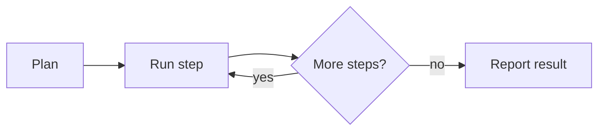

# Streaming and progress

An agent task can take seconds or minutes. The interface must show that something is happening, and what.

## Patterns

- **Streaming text.** Show the answer while it is written, so the user can start reading.
- **Step list.** Show the plan and tick off each step. The user sees where the agent is.
- **Cancel at any moment.** A visible stop button gives the user control.

## Show the work, not only the result

A step list such as "Searching the documents", "Reading 3 matches", "Writing the summary" builds trust. It also helps the user to spot a wrong turn early.

