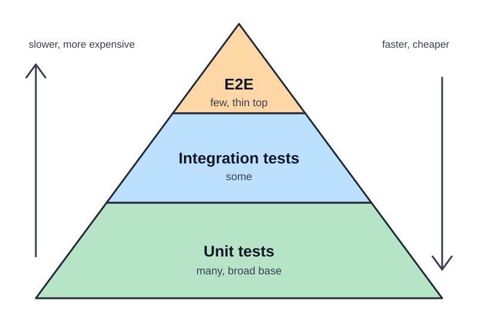
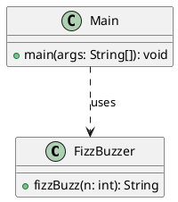

# Admonitions

An admonition is a block that stands out from the running text, with a visible start and a visible end. Use it for a remark, a tip, something that is easy to miss, a warning, or content that a learner may skip. The block looks the same in Brightspace and in the preview, and it does not rely on colour alone: every type has its own label, icon and border. A *note* and an *optional* block fold open and shut.

## The six types

:::note
A note adds information that is useful but not required. A note starts open and can be folded.
:::

:::tip
A tip shows a quicker or easier way to do something.
:::

:::important
Important content is a rule or a requirement that is easy to miss.
:::

:::warning
A warning tells the learner what can go wrong.
:::

:::caution
A caution is for the risk of lost work or lost data.
:::

:::optional
Optional content may be skipped, and starts folded: an extra assignment or extra depth.
:::

## A custom title

:::tip[Run the lint before you build]
`bso lint` finds most mistakes in a few seconds. The build takes longer, so lint first.
:::

## Longer blocks

A block holds ordinary Markdown: several paragraphs, lists, code, pictures and diagrams. The folded block below is a realistic *optional* part of a lesson.

:::optional[Going deeper: where does a FizzBuzz test belong?]
FizzBuzz is small, but it shows the idea of the test pyramid of [lesson 1.2](../week-1/lesson-2-test-strategy.md). A **unit test** checks one class and runs in milliseconds, so you can afford many of them:

```java
@Test
void multiplesOfThreeAreFizz() {
  assertEquals("Fizz", new FizzBuzzer().fizzBuzz(9));
}
```

The pyramid says how many tests of each kind a project needs:

- *Unit tests* are the broad base: one class, very fast.
- *Integration tests* check that components work together.
- *End-to-end tests* are few, slow and break easily.



The class diagram shows what the unit test above exercises, and what the test leaves out:


:::

## Blocks in the course

The other pages use admonitions where the content already was a remark or a warning:

- the warning *Do not omit `task`* on [What Brightspacosaurus does](../features.md);
- the note *Try both PowerPoint modes* on the [slides page](slides.md);
- the *Manual test* instructions of the lessons, which a learner may skip, for example in [lesson 2.1](../week-2/lesson-1-diagrams-and-svg.md);
- the *Teachers only* notice on the [teacher page](../for-teachers.md).

<details>
<summary>How to set up admonitions</summary>

Admonitions need no setup. Write a container directive: `:::` followed by the type, the content, and a closing `:::` on its own line. The type is `note`, `tip`, `important`, `warning`, `caution` or `optional`. Text in square brackets after the type is a custom title.

```md
:::important[Hand in on time]
The deadline is Friday.
:::
```

A block that holds another directive, for example a block inside a block, needs more colons on the outside:

```md
::::note
Outer text.

:::warning
Inner text.
:::

::::
```

There is one form. The quote form (`> [!NOTE]`) is not supported, because every line of a long block would need a `>`.

To change the label of a type, add this to the course configuration. The language of the other labels follows `diagrams.locale`.

```json
{
  "admonitions": {
    "labels": { "optional": "Extra" }
  }
}
```

`bso lint` warns about a mistyped type such as `:::optionl`, about a Docusaurus-only name such as `:::info`, about a block without content and about a block without its closing `:::`.

</details>
