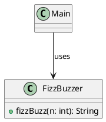
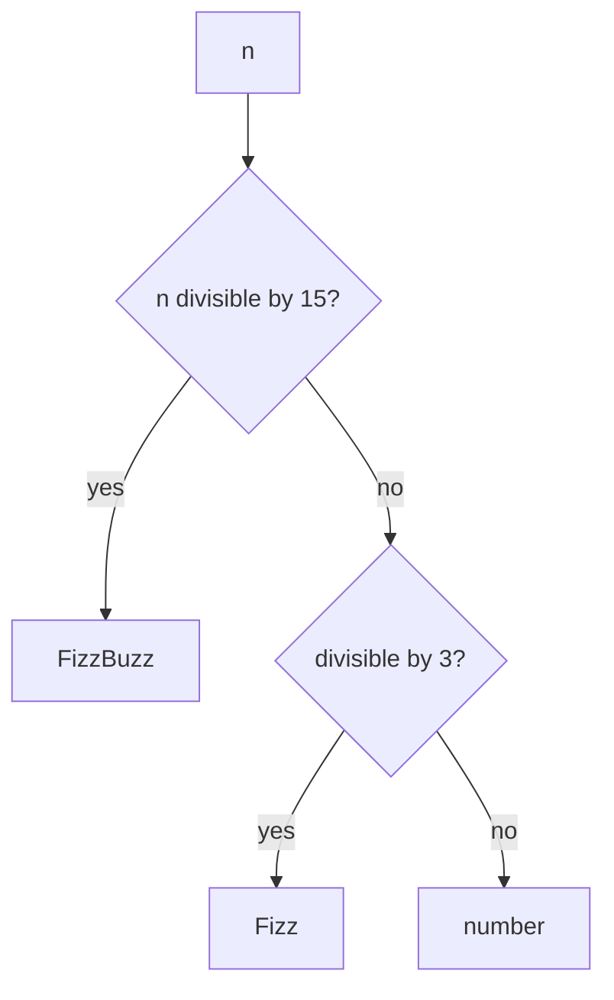

# Code and diagrams

Code blocks get syntax highlighting at build time and a copy button in Brightspace. Diagrams written as code render to images, each with an accessible name, a generated text description and its source behind a native disclosure.

## Code with syntax highlighting

```java
public class FizzBuzzer {
    public String fizzBuzz(int n) {
        if (n % 15 == 0) return "FizzBuzz";
        if (n % 3 == 0) return "Fizz";
        if (n % 5 == 0) return "Buzz";
        return String.valueOf(n);
    }
}
```

<details>
<summary>How to set up code blocks</summary>

Nothing to configure: every fenced code block with a language gets highlighting and a copy button. Name the language after the opening fence.

````markdown
```java
public class FizzBuzzer { }
```
````

</details>

## Diagrams as code

A class diagram in PlantUML:



The same decision flow in Mermaid:



<details>
<summary>How to set up diagrams</summary>

Write a `plantuml` or `mermaid` code block. BSO renders it through a Kroki server during the build. Optionally point to your own Kroki server and set the language of the generated labels (`nl` or `en`) in the course configuration:

```json
{
  "diagrams": {
    "krokiUrl": "http://localhost:8000/",
    "locale": "en"
  }
}
```

The language setting applies to the whole course; a second language on the same page is not supported yet.

</details>
