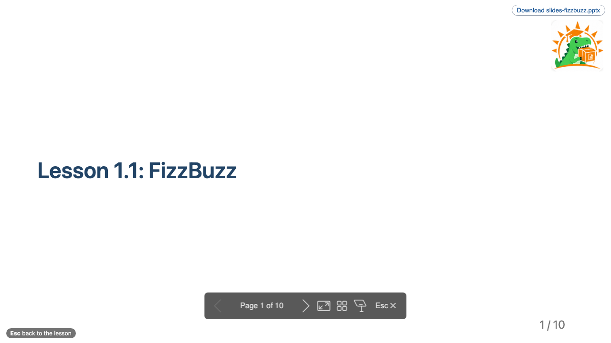
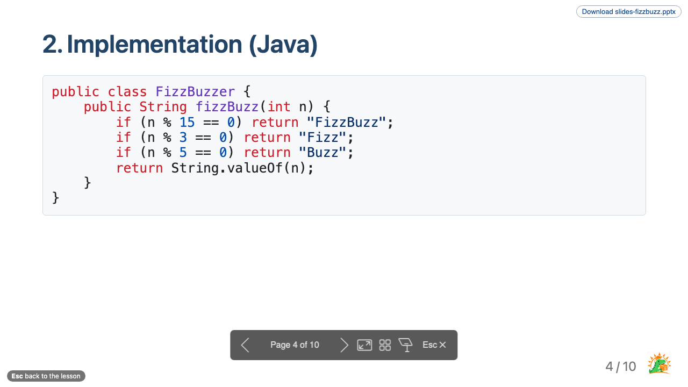

# Slides

Every lesson can be shown as slides, without writing a deck first. BSO turns the lesson into a presentation: a title slide, a contents slide, then one slide per section with its lists, tables, images, code and diagrams. Running text stays in the lesson. A teacher can also write a deck by hand and attach it to a lesson.

## What students and teachers do

- As a **student**, I open a lesson and click *Slides* (or press Alt+P, on a Mac Option+P) to see its extra slides in the same tab. The browser's Back button, or Esc, returns me to the lesson.
- As a **teacher**, I press Alt+T (Option+T on a Mac) to present the lesson itself, step by step, with the extra slides in the right place. No button, no setup per lesson.
- As a **teacher**, I present straight from the lesson. The slides follow the lesson, so there is no second file to keep up to date.
- As a **teacher**, I download an editable PowerPoint file of a hand-written deck when I want to adapt it for my own class.
- As a **course author**, I link my own deck in the lesson, where it belongs. The link starts the deck on its own, its slides appear in the lesson's slides at that place, and BSO tells me when a slide would come out empty. Lesson 1.1 does this.



Figure 1. The title slide: the lesson title and the course logo (the BSO logo when the course sets none).

Explanation: look at the centred title and the logo at the top right. The slide number at the bottom right reads `1 / 10`.



Figure 2. A content slide. The title always sits at the same place, the code of the section is on the slide, and the footer shows `4 / 10` and the logo.

Explanation: look at the fixed title position, which does not move with the amount of content, and at the controls under the slide (move the mouse to show them): previous and next, full screen, overview, presenter view and an *Esc* button that returns to the lesson.

## What is on the slides

- A **contents slide** lists all section headings, so number the sections of a lesson that becomes slides (`## 1. Introduction`). Sources and Bronnen stay unnumbered and are not counted.
- **Code** gets its own slide, and long code continues on the next slide.
- **PlantUML and Mermaid diagrams** are drawn through Kroki and get a slide each.
- Page numbers read `4 / 10`. Appendix slides (a section titled *Appendix* or *Bijlage*) are left out of the total.
- The preview shows a *Slides* button in the top right corner of every lesson that has extra slides (a deck written by hand). Alt+T presents the lesson itself and has no button; it works on the lessons that `generateForPrefix` selects (here the files that start with `lesson-`), not on overview, feature or quiz pages. In Brightspace the lesson page has the same button and keys, and the slides are not items of the menu; the *Download pptx* link is on the slides page of a hand-written deck.

**Try it in this course**

| Lesson | What you can do |
| --- | --- |
| [Lesson 1.1: FizzBuzz](../week-1/lesson-1-fizzbuzz.md) | Alt+T presents the lesson as slides, generated from the lesson text; the *FizzBuzz, step by step* deck, which the lesson links, is part of it. Alt+P (or the button) opens that extra deck alone. |
| [Lesson 1.2: Test strategy](../week-1/lesson-2-test-strategy.md) | Like lesson 1.1: Alt+T presents the lesson, and the extra slides *Where does this test belong?* (three practice cases that are not in the lesson text) are linked in the lesson and open with Alt+P or the button. |
| [Lesson 2.5: Test levels](../week-2/lesson-5-test-levels.md) | Alt+T presents the lesson with the three pages it links as nested sets. |

The lesson is not copied: the generated slides are made from the lesson file each time, so a change in the lesson shows in the slides. Only the extra deck is a separate file.

**Step-by-step lists.** In a hand-written deck a list written with `*` or `1)` shows its items one at a time, on a click or a key press, for example to ask a question and show the answer on the next click. See the practice cases of [lesson 1.2](../week-1/lesson-2-test-strategy.md). A list written with `-` shows everything at once. (Marp calls this a fragmented list; PowerPoint calls it 'animating bullet points one at a time'.)

<details>
<summary>How to set up slides</summary>

Slides need no setup for lessons whose file name starts with a prefix you choose. Add this to the course configuration:

```json
{
  "slides": {
    "generateForPrefix": "lesson-",
    "logo": "shared/logo.png",
    "pptx": true
  }
}
```

- `generateForPrefix` turns every lesson whose file name starts with the prefix into slides.
- `logo` is shown on the title slide and in the footer. Without it, BSO uses its own logo.
- `pptx` also writes an editable PowerPoint file for every hand-written deck. A deck overrides it with `pptx: true`, `pptx: false` or `pptx: auto` in its front matter.

A hand-written deck is a Markdown file with `slides: true` in its front matter. Link it in the lesson with an ordinary Markdown link (`[Extra slides](../../slides/slides-fizzbuzz.md)`): the link starts the deck on its own and its slides are inserted in the lesson's slides at that place. A deck without a lesson can also be attached with `slides.lessons`. Use `{@include: [text](path.md)}` to reuse another file on the slides, one level deep.

An overview lesson can show the slides of the pages it links to as nested sets with the setting `nest` (a glob such as `levels/level-*.md`): lesson 2.5 does this with three pages, numbered `2.1` to `2.3`. Only the links that match nest; the other links stay ordinary links.

`bso lint` warns about lessons that become slides when their headings have no number, when they have more than nine sections, and about a `---` separator that would give an empty slide.

The user manual has the full reference: *Presentations*.

</details>
