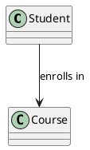

# Quiz 2.1: Diagrams

````quiz
? Which two diagram syntaxes are used in the demo reader?

- (x) PlantUML and Mermaid
- ( ) SQL and XML
- ( ) JSON and YAML
- ( ) CSS and HTML

? What should a diagram fallback preserve?

- (x) The original diagram source code
- ( ) Only an empty image placeholder
- ( ) The quiz answer key of the course
- ( ) Nothing, the diagram is dropped

? What does this class diagram say?



- (x) A student enrolls in a course
- ( ) A course enrolls in a student
- ( ) A student is a kind of course
- ( ) A course contains no students

? Which diagram shows that a `Course` is a kind of `Subject`?

- (x) This diagram:
  ```plantuml
  @startuml
  class Course
  class Subject
  Course --|> Subject
  @enduml
  ```
- ( ) That diagram:
  ```plantuml
  @startuml
  class Course
  class Subject
  Subject --|> Course
  @enduml
  ```
````
