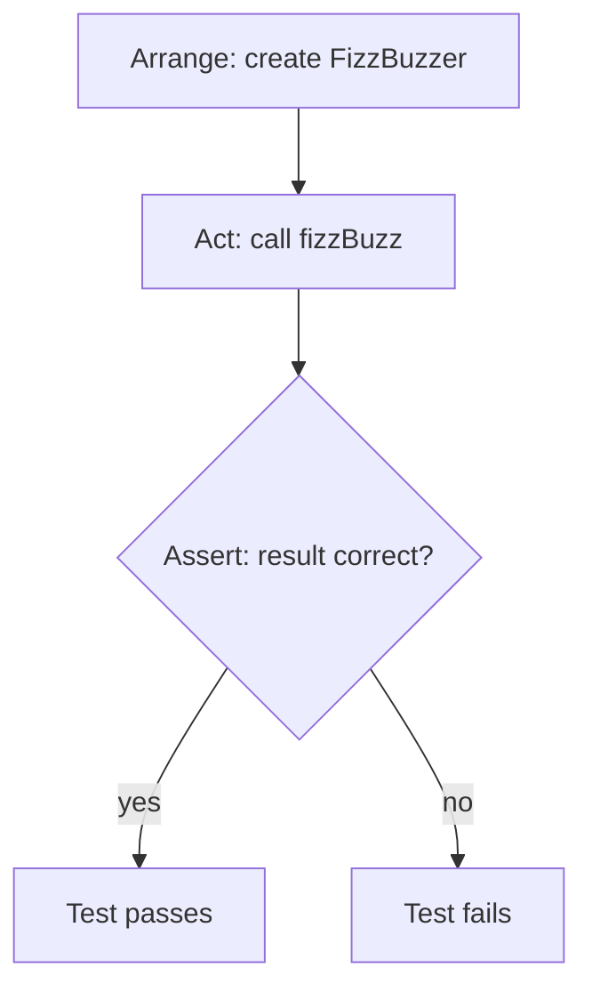
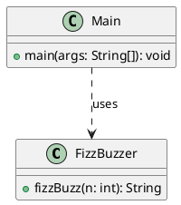

# Reader: Testing Basics

Example reader for the demo course of Brightspacosaurus

## 1. Learning objectives

{@include: [Learning objectives](../partials/learning-objectives.md)}

A short reference on the arrange-act-assert pattern for unit tests.

## 2. Arrange-Act-Assert

Most unit tests follow three phases:

1. **Arrange** — set up the object under test and any inputs.
2. **Act** — call the method being tested.
3. **Assert** — verify the result matches expectations.

## 3. Test flow

## 4. Class diagram

Keep tests small and focused: one behaviour per test, with a clear name that describes the expected outcome.
