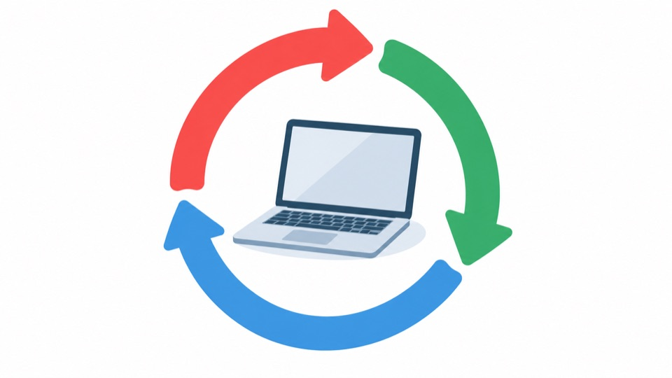
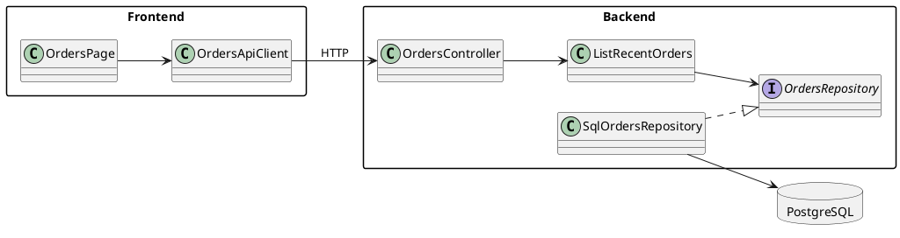
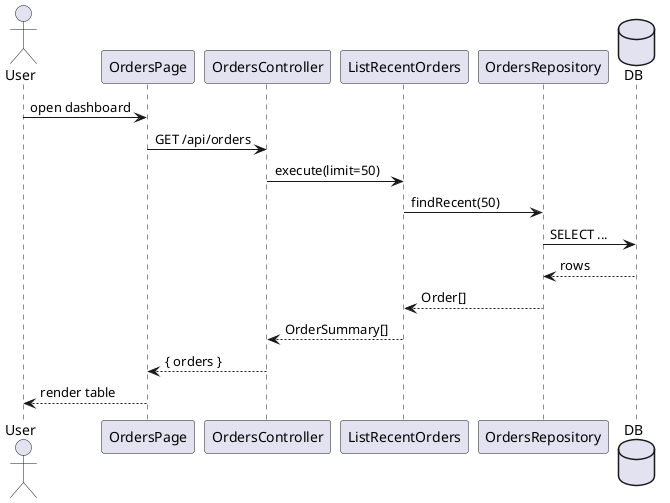

# Full-stack refactor walkthrough

From "fat component + fat route" to thin UI/API with one use-case.



<!-- Keep this as a code-heavy deck: front-end, back-end and diagrams on separate slides. -->

---

# The problem: every change touches everything

An orders dashboard loads recent orders from an API and displays them in a table.
Today, the React component owns fetching and rendering; the route owns SQL and mapping.

- Changing storage should not require rewriting an HTTP handler.
- Testing order rules should not require a browser or a database.
- We will extract responsibilities in small steps, keeping the existing behaviour covered.

<!-- These are teaching excerpts, not a complete runnable application. Imports, wiring and error middleware are omitted. -->

---

# Read the refactor as three small extractions

1. Move HTTP fetching out of the component into a client and hook.
2. Move application decisions out of the route into a use-case.
3. Move SQL behind a repository interface; test the real SQL separately.

The objective is not "more classes". Each boundary should make a real change or test easier.

---

# Before: one React component does everything

Fetching, loading state and rendering change together. Identify the network boundary before extracting it.

```tsx
export function OrdersPage() {
  const [state, setState] = useState<OrdersState>(initialState);
  useEffect(() => {
    fetch("/api/orders")
      .then((response) => {
        if (!response.ok) throw new Error("Request failed");
        return response.json();
      })
      .then(({ orders }) => setState({ loading: false, orders, error: null }))
      .catch((cause) => setState({
        loading: false, orders: [], error: String(cause),
      }));
  }, []);
  return <OrdersView {...state} />;
}
```

---

# Before: one Express route does transport + domain + SQL

The route knows both the HTTP response and database columns. A schema change now affects transport code.

```ts
router.get("/orders", async (_request, response) => {
  const rows = await db.query(`
    SELECT id, number, status, total_cents, customer_name
    FROM orders WHERE deleted_at IS NULL
    ORDER BY created_at DESC LIMIT 50
  `);
  const orders = rows.map((row) => ({
    id: row.id, number: row.number, status: row.status,
    total: row.total_cents / 100, customer: row.customer_name,
  }));
  response.json({ orders, generatedAt: new Date().toISOString() });
});
```

---

# Target architecture: one use-case in the middle

Follow the arrows: the use-case depends on a repository interface, not on SQL or Express.



---

# Request flow after the refactor

The request still makes one database call. The new boundaries change responsibility, not the user's journey.



---

# After: thin React component

The page chooses what to display; the hook owns request state. The client owns the HTTP protocol.

```tsx
export function OrdersPage() {
  const { orders, loading, error } = useOrders();
  return <OrdersView orders={orders} loading={loading} error={error} />;
}
```

---

# Extract the request state into a hook

Loading and failure remain visible states. In a complete application, also cancel or ignore requests after unmount.

```tsx
function useOrders() {
  const [state, setState] = useState<OrdersState>(initialState);
  useEffect(() => {
    ordersApiClient.listRecent()
      .then((orders) => setState({ loading: false, orders, error: null }))
      .catch((cause) =>
        setState({ loading: false, orders: [], error: String(cause) })
      );
  }, []);
  return state;
}
```

---

# After: thin controller + explicit use-case

The controller translates HTTP input. The use-case applies rules before asking the repository for data.

```ts
router.get("/orders", async (request, response) => {
  const limit = Number(request.query.limit ?? 50);
  const result = await listRecentOrders.execute({ limit });
  response.json({ orders: result.orders });
});
```

---

# Put application rules in the use-case

Validate a requested limit once here. HTTP error middleware must translate validation failures into a client error.

```ts
export class ListRecentOrders {
  constructor(private readonly repository: OrdersRepository) {}

  async execute({ limit }: { limit: number }) {
    if (!Number.isInteger(limit) || limit < 1 || limit > 200) {
      throw new Error("limit must be an integer between 1 and 200");
    }
    const orders = await this.repository.findRecent(limit);
    return { orders: orders.map(toOrderSummary) };
  }
}
```

---

# Why teams choose this refactor today

Introduce a boundary when it reduces coupling or makes a test simpler; avoid layers that only forward calls.

1. One place for domain rules (`ListRecentOrders`).
2. Smaller tests: hook tests, use-case tests, repository integration tests.
3. API and UI become easier to evolve independently.
4. Controller becomes transport-only (HTTP in, JSON out).


---

# Test split after the refactor

Use a repository double to test application rules quickly. These excerpts assume an arranged use-case and mock.

```ts
describe("ListRecentOrders", () => {
  it("rejects an invalid limit", async () => {
    await expect(() => useCase.execute({ limit: 0 })).rejects.toThrow();
  });

  it("maps entities to summaries", async () => {
    repository.findRecent.mockResolvedValue([order("SO-101", 4200)]);
    const result = await useCase.execute({ limit: 1 });
    expect(result.orders[0]).toEqual({ number: "SO-101", total: 42 });
  });
});
```

---

# Refactoring is not a behaviour change

First preserve the existing response shape, ordering and default limit with regression tests.

- The snippets omit imports, dependency wiring and HTTP error middleware; they are not a complete app.
- Configurable limits and validation are a separate feature, not a free part of the refactor.
- Keep `generatedAt` if existing clients consume it; inject a clock to make its test deterministic.
- Test SQL mapping with a real database and one complete browser-to-API journey separately.

<!-- The after snippet focuses on the new boundary, not a drop-in replacement for the original route. -->

---

# Your turn: make one change through the boundaries

Add a status filter without putting SQL in the controller or HTTP in the use-case.

1. Write a regression test for the existing unfiltered response.
2. Add a use-case test for filtering and a repository integration test.
3. Extend the API client and UI; verify loading and error states still work.

Explain which layer changed and why. If every layer duplicates the same rule, revisit the boundary.

---

# Sources

- Fowler, M. (2003). *Patterns of Enterprise Application Architecture*. Addison-Wesley.
- Evans, E. (2004). *Domain-Driven Design: Tackling Complexity in the Heart of Software*. Addison-Wesley.
- Illustrations generated with DALL-E; see `images/README.md` in the demo course sources.
