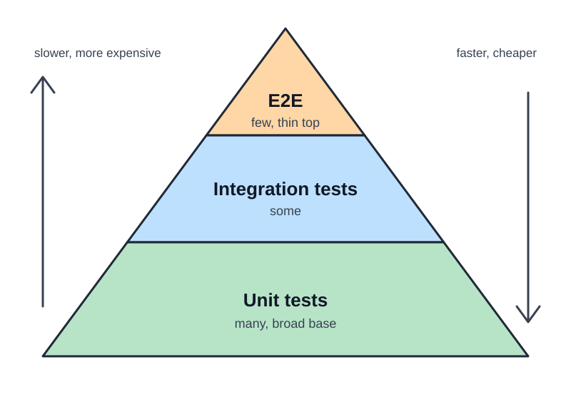
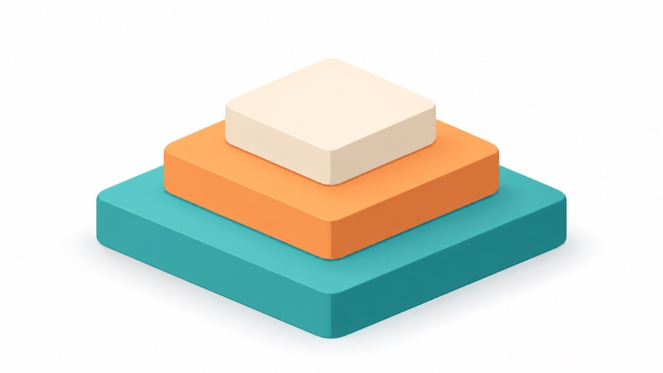

# Test pyramid and test strategy

Choose the right test at the right level.

<!-- Teacher notes stay out of the student-facing slide. -->

---

# The test pyramid

- Many unit tests at the base.
- Fewer integration tests.
- A thin top of end-to-end tests.

---

# Why the shape?

- Unit tests are fast and cheap.
- Integration tests need more set-up.
- E2E tests are slow and break easily.

---

# Credits

- Pyramid after Chaves (2025).
- Illustrations generated with DALL-E; see `images/README.md` in the demo course sources.
