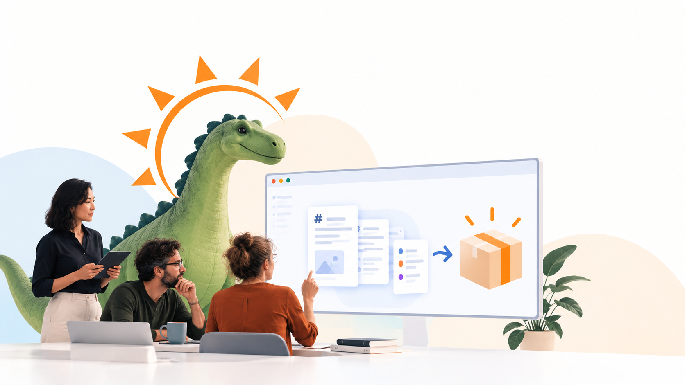
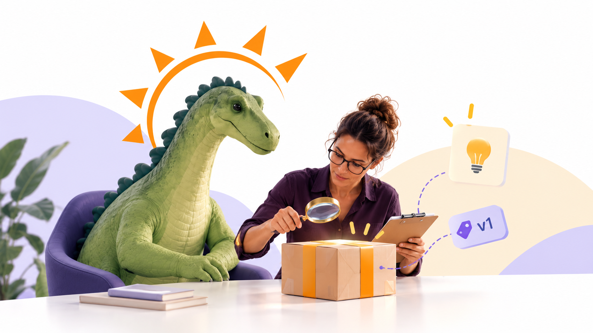

# Visuals for demo course

From Chat-GPT.

## Algemeen

*Illustratie: gegenereerd met OpenAI ChatGPT (beeldgeneratie). Prompt achteraf gereconstrueerd op basis van het eindresultaat; niet de letterlijke oorspronkelijke invoer.*

> "A wide 16:9 editorial hero illustration for a professional educational technology demo course.
> 
> Three adult educators with diverse appearances collaborate around a laptop and a large floating digital interface. A friendly, semi-realistic green dinosaur mascot stands behind them, with a distinctive orange sunburst halo inspired by the Brightspacosaurus identity.
> 
> The digital interface shows Markdown course content being transformed into a structured learning package, represented by floating document cards, interface components and an orange shipping box.
> 
> Visual style: Clean, contemporary editorial illustration combining realistic human figures, a softly textured dinosaur and minimal flat UI graphics. Professional and approachable, not cartoonish or childish. Natural expressions and restrained gestures.

Color palette: White and off-white, soft powder blue, pale peach, muted green and Brightspace orange (#F5A623).

Composition: Generous whitespace, soft abstract background shapes, subtle shadows, balanced asymmetrical layout, bright diffused studio lighting.

No text, no labels, no watermark. Landscape 16:9."

Second take for the whole course, kept as an alternative:

## Week 1

> "Een docent typt aan een laptop; uit het scherm vliegen codeblokken, een link-ketting, een kaartje om om te draaien (flashcard) en een toetsenbord. De dinosaurus kijkt mee en wijst naar een link. Mint en lavendel."

## Week 2

> "Een docent en de dinosaurus pakken een doorzichtig pakket in met diagrammen (blokjes met pijlen), een pdf-blad en een versielabel. Een lopende band loopt naar een open doos met een lat. Oranje en diepblauw."

## BSO Features

> "De dinosaurus staat voor een prikbord met zes kleine pictogrammen (quiz, diagram, flashcards, slides, controle-vinkje, menu), elk in een eigen kleurvlak. Divers publiek kijkt toe. Geel en turquoise."

## Voor docenten

> "Een docent met een klembord en een vergrootglas inspecteert een pakketje; een lampje en een klein versienummer-label (zonder tekst). De dinosaurus zit op een stoel naast de docent. Paars en goud."

